# Shareholder pack

A briefing on the business, assembled from the company's own operating data and skinned as a
16-bit management game. Twelve slides: the business in brief, the network, the executive group,
one slide for each seat — finance, operations, revenue, customer experience, fleet, people and
data — and a case study of the storm week that broke Paris.

[**Open the deck &rarr;**](shareholder-deck/presentation.html){ .md-button .md-button--primary }
Use the arrow keys to move, `f` for full screen, and print to PDF for a handout.

## Slide by slide

[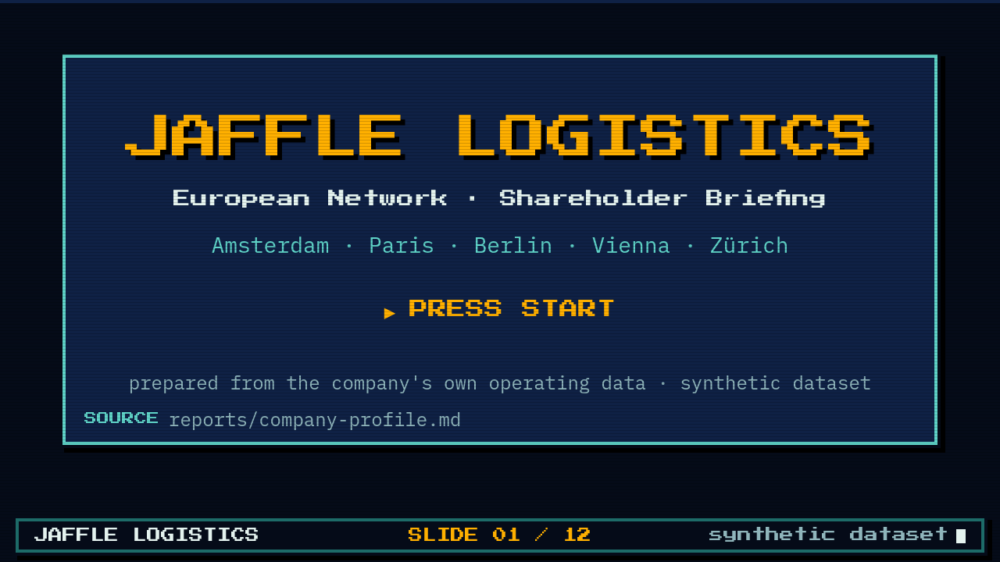](shareholder-deck/presentation.html)
[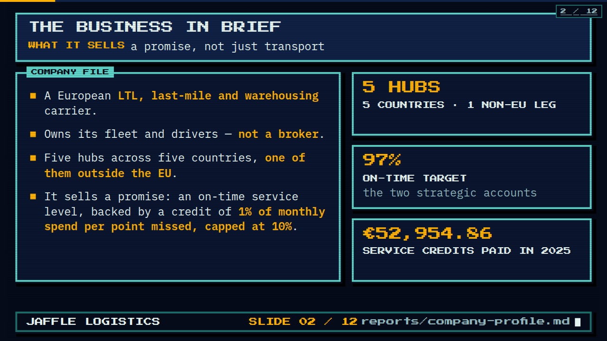](shareholder-deck/presentation.html)
[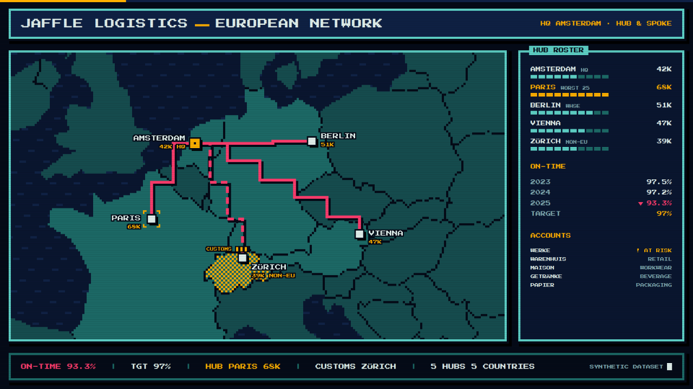](shareholder-deck/presentation.html)
[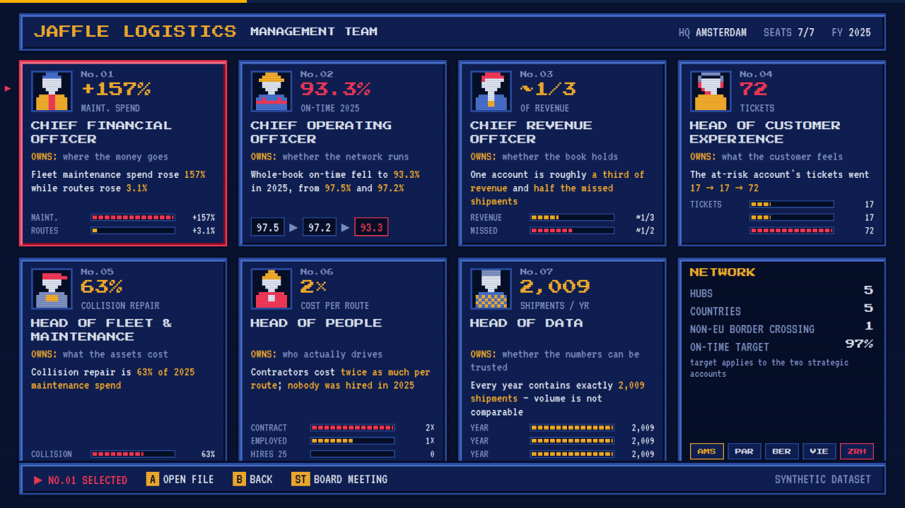](shareholder-deck/presentation.html)
[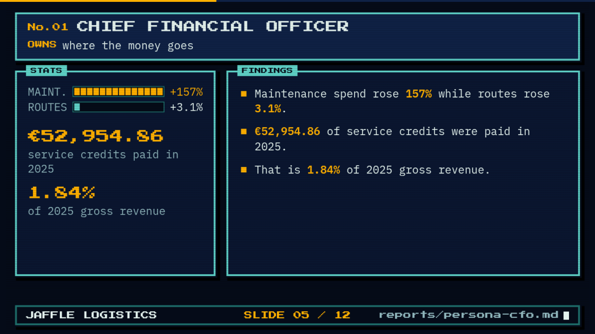](shareholder-deck/presentation.html)
[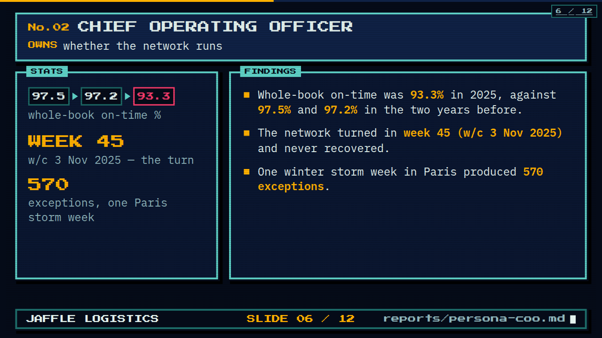](shareholder-deck/presentation.html)
[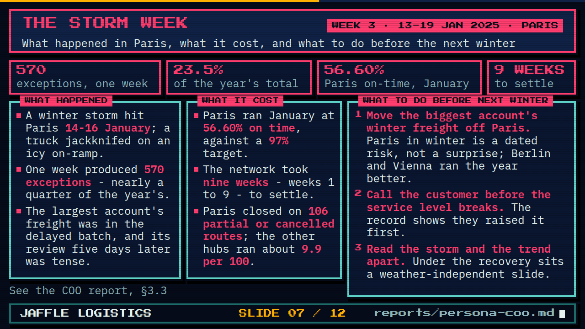](shareholder-deck/presentation.html)
[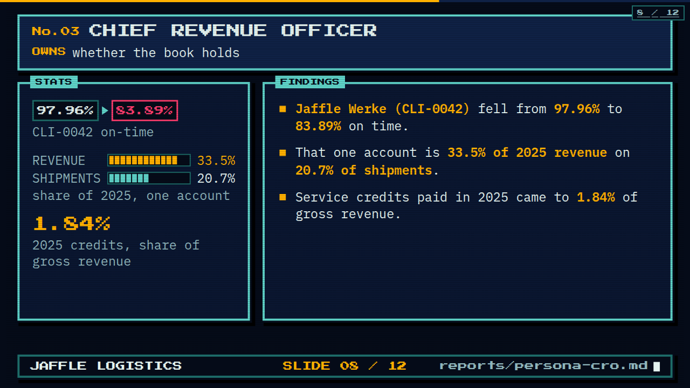](shareholder-deck/presentation.html)
[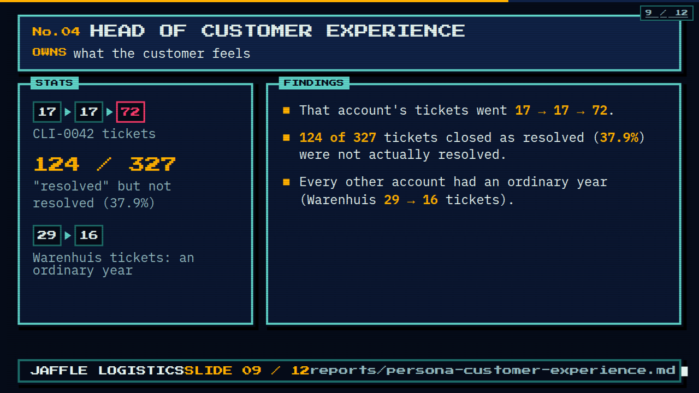](shareholder-deck/presentation.html)

[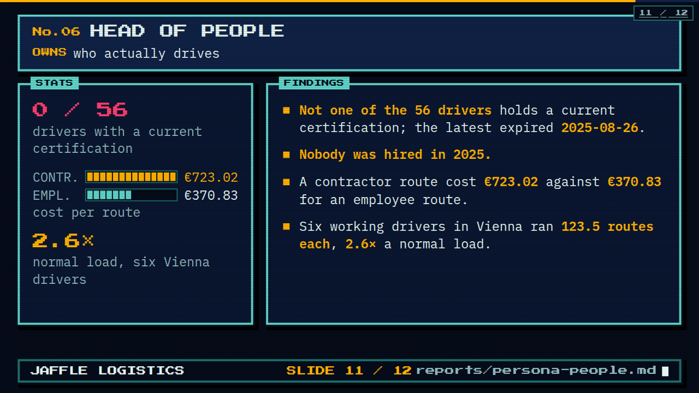](shareholder-deck/presentation.html)
[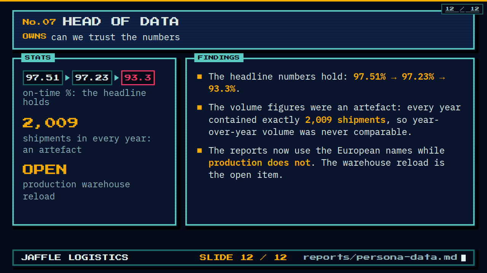](shareholder-deck/presentation.html)

## The graphics, in three styles

| Network map | Executive group |
|---|---|
| [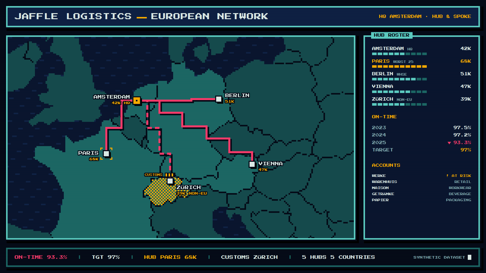](shareholder-deck/png/map-retro.png) | [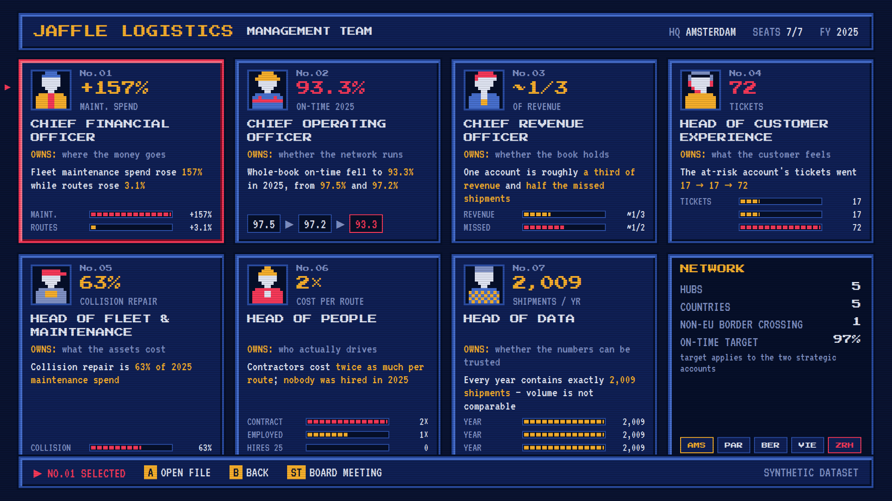](shareholder-deck/png/exec-retro.png) |
| [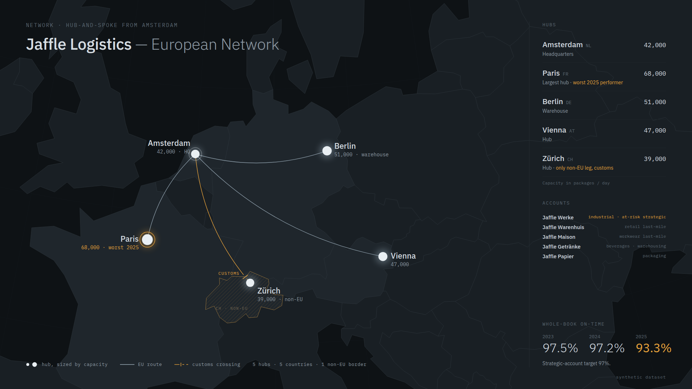](shareholder-deck/png/map-dark.png) | [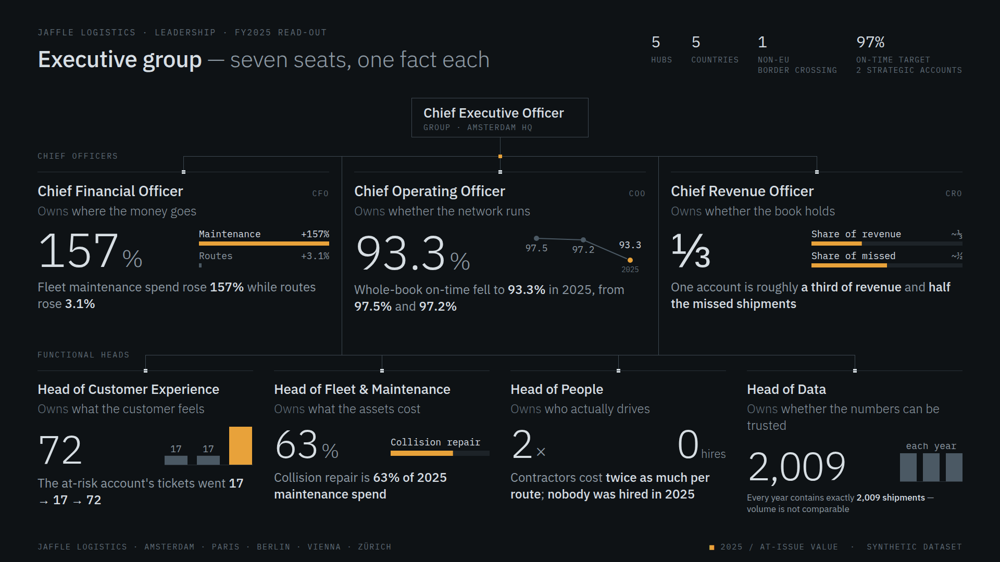](shareholder-deck/png/exec-dark.png) |
| [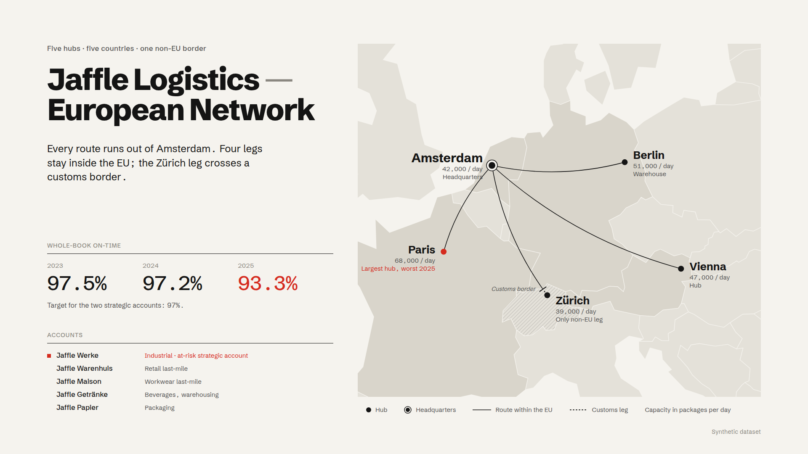](shareholder-deck/png/map-light.png) | [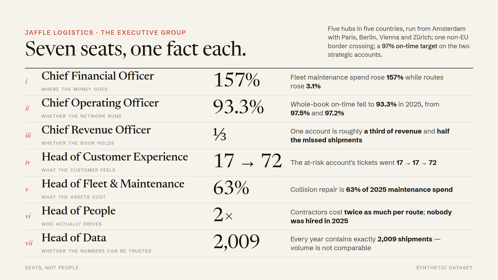](shareholder-deck/png/exec-light.png) |

## The reports behind every slide

Each slide carries one seat's verified numbers, and names the report it came from. Those reports
live in the repository:

| Seat | Report |
|---|---|
| Chief Financial Officer | [persona-cfo.md](https://github.com/boxysean/jaffle-logistics-europe/blob/main/reports/persona-cfo.md) |
| Chief Operating Officer | [persona-coo.md](https://github.com/boxysean/jaffle-logistics-europe/blob/main/reports/persona-coo.md) |
| Chief Revenue Officer | [persona-cro.md](https://github.com/boxysean/jaffle-logistics-europe/blob/main/reports/persona-cro.md) |
| Head of Customer Experience | [persona-customer-experience.md](https://github.com/boxysean/jaffle-logistics-europe/blob/main/reports/persona-customer-experience.md) |
| Head of Fleet & Maintenance | [persona-fleet.md](https://github.com/boxysean/jaffle-logistics-europe/blob/main/reports/persona-fleet.md) |
| Head of People | [persona-people.md](https://github.com/boxysean/jaffle-logistics-europe/blob/main/reports/persona-people.md) |
| Head of Data | [persona-data.md](https://github.com/boxysean/jaffle-logistics-europe/blob/main/reports/persona-data.md) |

!!! warning "The dataset is synthetic"
    Jaffle Logistics is a worked example, not a real carrier. Nothing here is a real company's
    numbers, and no market or competitor data was available to the analysis — so the deck makes
    no claim about rivals or market share.
