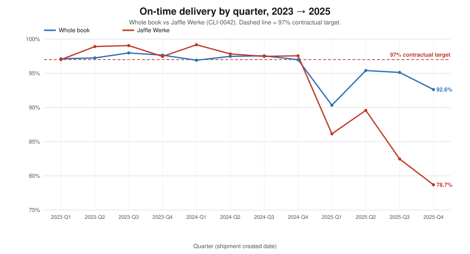
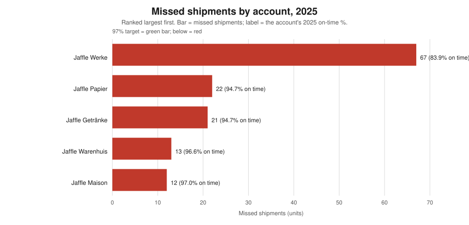
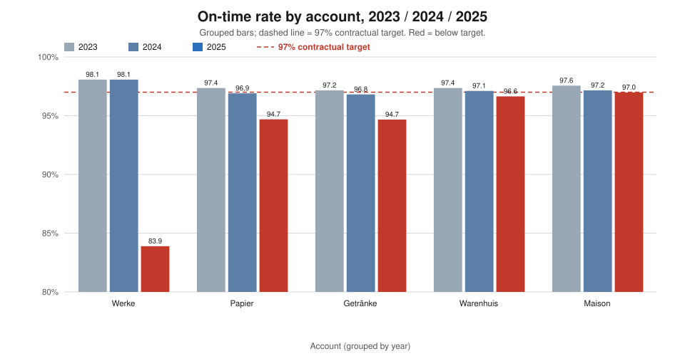
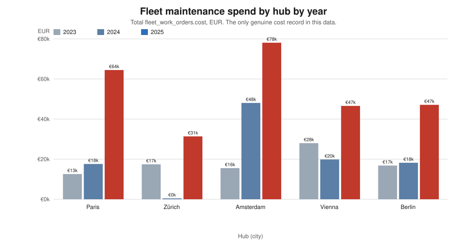
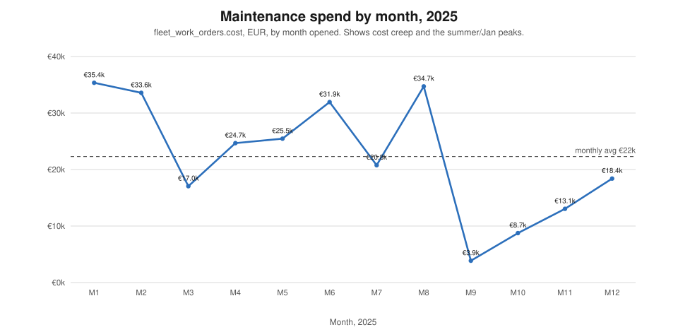
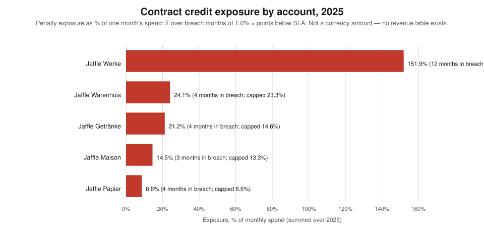
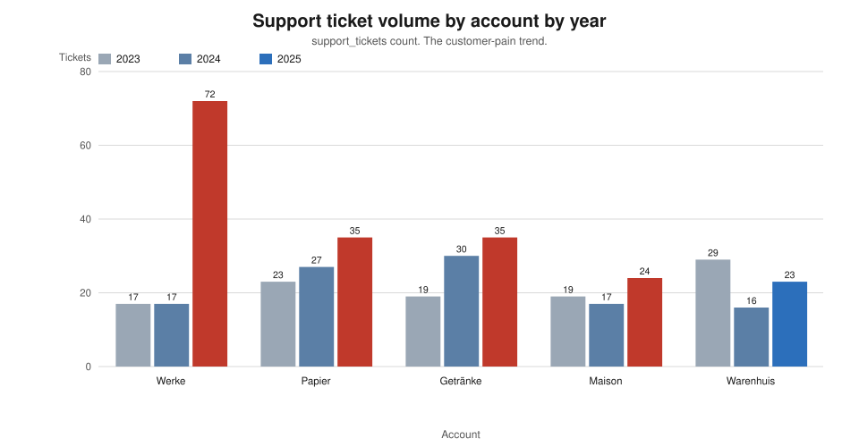
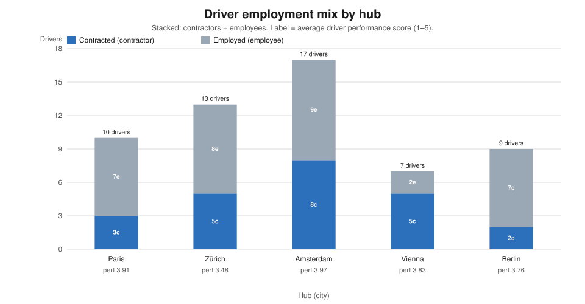

# CFO arrival briefing — the state of Jaffle Logistics

**To:** the incoming Chief Financial Officer, end of week one
**From:** analysis desk (Bruno)
**Data present:** operating history through **2025-12-31**; 2023 and 2024 are the quiet comparison years.
**Source:** every figure below comes from a query run through the dbt Platform remote MCP
(`execute_sql`) against `hive_metastore.dbt_smcintyre_jaffle_logistics_prod`. The SQL is in §8.
On-time means `status = 'delivered'`; `delayed`, `failed` and `returned` are misses. All money is in
euros, the reporting currency. Zürich-local costs are invoiced in CHF and converted at a fixed synthetic
rate of 0.95 (`vars.yml`); only the euro amount is stored.

> **Revised since first issue.** This briefing was first written when the warehouse held no revenue
> ledger, no cost ledger, no payroll, no promised-delivery date and no bay-level dock record. All five
> have since landed, and the 2023–2024 shipment history was expanded. The figures below are re-run
> against the current warehouse, and each place where the first issue no longer holds says so. The
> fuller financial picture built on the new ledgers is in [`persona-cfo.md`](persona-cfo.md).

---

## 1. The state of the business in five bullets

- **Healthy:** the business *can* hit its 97% service target — it did for two full years (2023 = 97.51%
  on 1,848 shipments, 2024 = 97.23% on 1,949), and two accounts (Maison, Warenhuis) are within about a
  point of their quiet-year levels.
- **Not healthy:** 2025 missed **135 shipments of 2,009 (93.28%)**, against 46 (2023) and 54 (2024).
  That is **81 extra misses**, and **59 of them — 73% of the deterioration — sit in one account, Jaffle
  Werke (`CLI-0042`)**, which fell from 97.77% / 97.96% in the quiet years to **83.89%**.
- **What it is costing:** fleet maintenance (`fleet_work_orders.cost`) **more than doubled, from €104k
  (2024) to €268k (2025)**, with the Amsterdam hub alone at €78k. The cost ledger now in the warehouse
  puts total non-labour cost at €7.18m and driver labour at €1.84m for 2025; the revenue ledger puts
  gross revenue at €2.88m. Those two ledgers do not yet describe the same business, so **no margin can
  be stated** (see `persona-cfo.md` §4.4).
- **What is exposed:** the revenue ledger records **€52,954.86 of contract credits in 2025, €51,269.00
  of them Jaffle Werke's (5.32% of its gross)**. On the calendar-month method this briefing first used,
  the 2025 misses imply **152% of one month's spend for Jaffle Werke** (contract-capped to ~102%) and
  single digits to ~24% for the other four. The ledger's lower figure comes from measuring on a
  trailing 12-month rate (§5).
- **What is unknown:** the margin (the ledgers are not scoped to the same activity), the cost of serving
  any one account (only maintenance is attributed, by stop share), and what the 2025 failure cost beyond
  the contract credit. The decline can now be *priced* at its contractual value; its full cost still
  cannot.

---

## 2. Where we are performing well

The reference point is the quiet years, not last quarter.

- **The whole book ran at ~97.5% / ~97.2% on time through 2023 and 2024** — 46 misses on 1,848
  shipments and 54 on 1,949. The target is reachable; 2025 is the outlier, not the norm.
- **Two accounts held their line.** Jaffle Maison fell only 0.66 points over three years
  (97.64% → 96.98%) and Jaffle Warenhuis 1.10 points (97.74% → 96.64%, but only 0.40 from 2024). Their
  2025 miss counts (12 and 13) are barely above their quiet-year counts (9 and 8 in 2023, 11 and 11 in
  2024).
- **Expedited service is the strongest service level**: 96.07% on time across 407 shipments in 2025,
  against 95.37% for standard.
- **Zürich is the least-stressed hub** on cost: its 2025 maintenance of €31k is the lowest of the
  five hubs and its maintenance per route (€44) is less than half Amsterdam's (€110).

**One sentence on the chart below:** the whole book (blue) and Jaffle Werke (red) track each other
at ~97–98% for eight quarters, then both break in 2025 — and Werke never recovers, ending the year
at 78.7%.



---

## 3. Where we are not

### 3.1 The deterioration, decomposed

**By account (2025):** the misses are not spread evenly.

| Account (`client_id`) | 2025 shipments | 2025 missed | 2025 on-time | 2023 on-time | 2024 on-time |
|---|---:|---:|---:|---:|---:|
| Jaffle Werke (`CLI-0042`) | 416 | **67** | **83.89%** | 97.77% | 97.96% |
| Jaffle Papier (`CLI-0201`) | 414 | 22 | 94.69% | 97.17% | 97.32% |
| Jaffle Getränke (`CLI-0169`) | 394 | 21 | 94.67% | 97.26% | 96.73% |
| Jaffle Warenhuis (`CLI-0007`) | 387 | 13 | 96.64% | 97.74% | 97.04% |
| Jaffle Maison (`CLI-0155`) | 398 | 12 | 96.98% | 97.64% | 97.09% |
| **Total** | **2,009** | **135** | **93.28%** | **97.51%** | **97.23%** |

*The misses reconcile: 67 + 22 + 21 + 13 + 12 = **135**, the whole-book 2025 total.*

**By hub (2025):** Paris is where the loss lands physically.

| Hub (city) | 2025 shipments | 2025 missed | 2025 on-time |
|---|---:|---:|---:|
| Paris (`HUB-PAR`) | 412 | **48** | **88.35%** |
| Berlin (`HUB-BER`) | 425 | 28 | 93.41% |
| Vienna (`HUB-VIE`) | 427 | 27 | 93.68% |
| Zürich (`HUB-ZRH`) | 398 | 16 | 95.98% |
| Amsterdam (`HUB-AMS`) | 347 | 16 | 95.39% |
| **Total** | **2,009** | **135** | **93.28%** |

*Reconciles: 48 + 28 + 27 + 16 + 16 = **135**. Of Paris's 48 misses, 22 were Jaffle Werke's (Q25).*

**By service level (2025):** `freight` is 479 shipments at 86.01%. All 416 of Jaffle Werke's shipments
are `freight`, and all 67 freight misses are Werke's; the other 63 freight shipments (Warenhuis 31,
Getränke 32) were all on time. So "freight" is a relabelling of the account, **not** an independent
driver. Standard = 1,123 shipments at 95.37%; expedited = 407 at 96.07%.

**One sentence on the charts below:** the loss concentrates in one account (Werke, 67 of 135 misses)
and its three-year bars show a collapse from about 98% to 83.9% while the other four accounts sag only
1–3 points; the grouped bars make the outlier obvious.





### 3.2 Operational efficiency — one hub is out of line

Routes, stops and exceptions per hub, 2025:

| Hub | Routes | Stops | Exceptions | **Exceptions / route** | Routes / driver |
|---|---:|---:|---:|---:|---:|
| Paris | 748 | 30,427 | 931 | **1.24** | 83.1 (9 drivers) |
| Zürich | 712 | 30,523 | 352 | 0.49 | 59.3 (12 drivers) |
| Amsterdam | 709 | 29,213 | 369 | 0.52 | 47.3 (15 drivers) |
| Vienna | 741 | 30,752 | 382 | 0.52 | **123.5 (6 drivers)** |
| Berlin | 719 | 29,787 | 387 | 0.54 | 89.9 (8 drivers) |

**Paris's exception rate (1.24 per route) is 2.3–2.5× every other hub's**, and it rose from 0.71 in
2024 and 0.79 in 2023 — the same hub that carries 48 of the year's 135 misses. Most of it is one
January storm (see the [COO report](persona-coo.md) §3.3). **Vienna runs 123.5 routes per driver on only
6 drivers**, more than double Amsterdam's 47.3 — a coverage/overload signal, not a cost signal. Vehicle
counts are Paris 10, Zürich 7, Amsterdam 11, Vienna 6, Berlin 10; odometer spread within each hub is
wide (e.g. Amsterdam 8,850–239,941), so the fleet is a mix of new and high-mileage units.

### 3.3 Risk and safety

Incidents rose every year: **100 (2023) → 110 (2024) → 174 (2025)**. The move is concentrated in
**damage**: 7 → 8 → **40**, of which **14 in 2025 are severity 3–4** (0 and 0 in the quiet years).
Amsterdam carries **15 of the 2025 damage incidents** (Vienna 9, Zürich 8, Berlin 5, Paris 3). **This is
a worsening pattern, and the severity mix is worsening with it.** *(The Amsterdam handling-damage
cluster is examined in [`amsterdam-damage-forensics.md`](amsterdam-damage-forensics.md). When this
briefing was first written, the causal claim rested on a single incident report. The warehouse now
holds bay-level dock records, and they place 11 of Amsterdam's 15 damage events at one bay, bay 3, so
"why Amsterdam" is now supported by data and not only by narrative. The rise at the other four hubs is
not explained by it.)*

---

## 4. Where the money goes

**Fleet maintenance (`fleet_work_orders.cost`) is the cost line closest to the operation**, and the one
this briefing was first built on. The cost ledger and payroll that have since landed are summarised at
the end of this section.

**Maintenance by hub by year (EUR):**

| Hub | 2023 | 2024 | 2025 | 2025 per route | 2025 per 1,000 shipments |
|---|---:|---:|---:|---:|---:|
| Paris | 12,576 | 17,588 | 64,456 | €86 | €156k |
| Zürich | 17,423 | 437 | 31,362 | €44 | €79k |
| Amsterdam | 15,538 | 48,044 | 78,083 | €110 | €225k |
| Vienna | 27,990 | 19,829 | 46,581 | €63 | €109k |
| Berlin | 16,828 | 18,203 | 47,096 | €66 | €111k |
| **Total** | **90,355** | **104,101** | **267,578** | | |

Maintenance **rose 157% year on year** and work orders doubled (41 → 81). **Amsterdam is the most
expensive hub per unit of work** (€110 per route, €225k per 1,000 shipments); Paris's cost per
shipment is also well above its peers and it jumped 3.7× in one year. Zürich's figures are converted
from CHF at the fixed 0.95 assumption.

**Maintenance by month, 2025:** two peaks (Jan €35k, Aug €35k) and a collapsed autumn (Sep €3.9k, Oct
€8.7k), against a monthly average of €22k. This briefing first read the peaks as planned work. **They
were not:** 96% of January's spend and 72% of August's was collision and jackknife repair (Q24). The
peaks are crash bills, so they say more about safety than about a maintenance plan.

**People signals.** 56 drivers on the books (23 contractors, avg performance 3.93; 33 employees, avg
3.70). Vienna runs the most contractor-heavy crew (5 of 7) and Amsterdam the next (8 of 17); Paris,
the hub with the most misses, is mostly employees (7 of 10). Zürich and Berlin have the lowest average
driver scores (3.48 and 3.76). 133 HR documents exist (56 onboarding, 30 review, 20 certification, 15
training, 11 disciplinary, 1 exit). Payroll now records hours, rates and overtime: 2025 driver labour
was €1,841,275, and overtime hours rose from 1,452 to 2,485.

**What the data now holds, and what it still does not.** The warehouse now has a revenue ledger, a
non-labour cost ledger by hub, payroll and a promised-delivery date with hours late. Recorded cost
(€9.02m in 2025) is about 3.1 times recorded revenue (€2.88m) in every year, which says the ledgers
cover different scopes rather than that the company loses €6m a year. **A defensible margin, a true
cost per shipment, or the full cost of the 2025 decline still cannot be stated**, and I have not
produced one.

**One sentence on the charts below:** maintenance more than doubled in 2025 at four of the five hubs
(Amsterdam, already the most expensive in 2024, rose 1.6×), with Amsterdam and Paris the largest bills,
and the monthly line shows the Jan and Aug crash-repair peaks against a €22k average.





---

## 5. Financial exposure — the contract credit calculation

**What the contracts say.** Each account's standing contract (`contracts.credit_terms`) reads:

> *"1.0% of monthly spend credited per full percentage point below the SLA on-time target, capped at
> 10% of monthly spend."*

and each carries a committed service level (`contracts.sla_ontime_pct`). The standing (latest
effective) targets are:

| Account | Contract | SLA target |
|---|---|---:|
| Jaffle Werke (`CLI-0042`) | `CON-0042-02` (eff. 2025-05-12) | 97.0% |
| Jaffle Warenhuis (`CLI-0007`) | `CON-0007-01` (eff. 2022-04-16) | 97.0% |
| Jaffle Maison (`CLI-0155`) | `CON-0155-01` (eff. 2023-07-28) | 95.0% |
| Jaffle Getränke (`CLI-0169`) | `CON-0169-01` (eff. 2024-06-24) | 95.0% |
| Jaffle Papier (`CLI-0201`) | `CON-0201-01` (eff. 2024-06-14) | 92.0% |

**The formula, and its inputs.** For each account and each month of 2025 I computed the points by
which the month's on-time rate fell below the account's SLA, then:

```
exposure% = Σ over the 12 months of 2025 of  [ credit_rate × max(0, SLA_target − on_time%_month) ]
          = 1.0% × (mean points below, over breach months) × (months in breach)
capped figure = Σ over months of  min( credit_rate × max(0, points below), 10% )
```

`credit_rate = 1.0%` (from the contract text). `points below` is per month, from the monthly on-time
series in §8 (query Q8). The 10% cap is per month.

**Ranking (2025):**

| Rank | Account | Months in breach | Uncapped exposure (% of one month's spend) | Contract-capped |
|---:|---|---:|---:|---:|
| 1 | **Jaffle Werke (`CLI-0042`)** | 12 / 12 | **151.9%** | 101.9% |
| 2 | Jaffle Warenhuis (`CLI-0007`) | 4 / 12 | 24.1% | 23.3% |
| 3 | Jaffle Getränke (`CLI-0169`) | 4 / 12 | 21.2% | 14.6% |
| 4 | Jaffle Maison (`CLI-0155`) | 3 / 12 | 14.5% | 13.3% |
| 5 | Jaffle Papier (`CLI-0201`) | 4 / 12 | 8.6% | 8.6% |

**Read this carefully.**

- **The ledger now records what was actually credited, and it is lower.** The revenue ledger applies
  the same rule to a **trailing 12-month** on-time rate (`measurement_basis = 'trailing_12m'`), not the
  calendar month used above. On that basis 2025 credits were **€52,954.86**: Jaffle Werke €51,269.00
  (5.32% of its gross, 12 months credited), Warenhuis €1,301.98, Getränke €383.88, Maison and Papier
  nothing (Q26). The table above is kept as a cross-check, not as the recorded figure.
- **Which reading is contractual is open.** The master services agreements say on-time is "measured
  monthly". If a customer reads that as the calendar month, the gap between the two methods is worth
  about €49,644 across all accounts in 2025 (see the [CRO report](persona-cro.md) §3.3).
- **Jaffle Werke is exposed every single month of 2025** on either method. On the calendar-month
  method its uncapped exposure (152% of a month's spend) exceeds a full year of capped credit
  (12 × 10% = 120%); the 10%-per-month cap bounds it to ~102% of one month's spend. On the ledger's
  trailing method the cap bound in November and December.
- **The SLA in force did not change during 2025.** This briefing first said Werke's target was 95.5%
  until the 2025-05-12 amendment. That was wrong: the 95.5% target (`CON-0042-00`) ran from 2021; it
  was raised to 97.0% on 2023-11-14 (`CON-0042-01`), and `CON-0042-02` kept 97.0%.

**One sentence on the chart below:** exposure is a one-account problem — Jaffle Werke's bar is more
than six times the next account's, and it is the only account that is in breach all twelve months.



---

## 6. Concentration and structural risk

- **Volume is near-equal by design, so volume cannot show true concentration.** In 2025 the five
  accounts each carry 19–21% of shipments (Werke 416, Papier 414, Maison 398, Getränke 394, Warenhuis
  387) and the five hubs each 17–21% (Vienna 427, Berlin 425, Paris 412, Zürich 398, Amsterdam 347).
  This briefing first said volumes were identical every year (2,009 shipments); they are not — 1,848,
  1,949 and 2,009 — but the even split by account is still a property of the dataset, not a
  diversification story. **Revenue is where the concentration shows:** Jaffle Werke is 20.7% of 2025
  shipments but 33.5% of gross revenue (Q26).
- **The loss is single-account and single-hub.** One account (Werke) carries 59 of the 81 extra misses
  (73%), and one hub (Paris) carries 35 of them (43%) and 48 of the year's 135 misses (36%). That is
  the concentration that matters, and it is real within this corpus.
- **Cost can now be attributed to an account, but only partly.** On the shipment record, **676 of the
  3,474 routes that carry shipments serve more than one client** (568 serve two, 99 serve three, 9
  serve four). A route-to-client attribution table now spreads each route across its clients by stop
  share, and on that basis 8,333 of all 10,488 routes are shared (Q27). Only maintenance is allocated
  through it, and it charges cost by stops, not by failure, so it is not a per-account P&L.
- **Vienna's staffing is a structural risk:** 741 routes on 6 drivers (123.5 routes/driver) is thin
  cover; one absence is a material share of the hub's capacity.

**One sentence on the charts below:** ticket volume is flat across 2023–2024 and then jumps for Jaffle
Werke alone (17 → 17 → 72), and the driver mix shows contractor-heavy Vienna and Amsterdam alongside
the lowest average driver scores at Zürich.





---

## 7. What I would demand in my first 90 days

Each item names the gap and the decision it blocks. Where data has landed since this briefing was
first written, the item says what is still missing.

1. **One scope for the revenue and cost ledgers, by account and by month.** Both ledgers now exist,
   but recorded cost is about 3.1× recorded revenue in every year, so they do not cover the same
   activity. *Blocks:* every margin, profitability and pricing decision, and any valuation of the 2025
   failure beyond its contractual credit.
2. **Per-account cost attribution that charges failure where it happens.** Routes serve up to four
   clients; the new attribution spreads only maintenance, by stop share, and gives Jaffle Werke the
   *lowest* allocation of the five. *Blocks:* knowing whether Jaffle Werke is profitable at all, and
   whether its credits are worth absorbing or renegotiating.
3. **A settled reading of the SLA clock.** Shipments now carry a promised-delivery date and hours
   late, so *how* late is measurable (55 of Werke's 59 delayed shipments were over two days late). What
   is not settled is whether the contract measures monthly or on a trailing 12 months. *Blocks:* the
   credit liability and the 97% conversation with Jaffle Werke.
4. **The missing operational feed that flags a decline before the customer calls.** The 2025 collapse
   was visible in the customer's tickets (Werke tickets 17 → 72) before our own records named it.
   *Blocks:* any proactive account-management motion.
5. **Payroll tied to the work it pays for.** Payroll now gives wages, hours and overtime by driver and
   hub, but not by route or account. *Blocks:* cost-per-route and labour-productivity analysis, and
   whether the 71% rise in overtime hours bought service or covered for failure.
6. **A statement of which volumes and splits are synthetic.** Volumes now vary by year, but the near-
   even split across accounts and hubs is a property of the dataset. *Blocks:* customer- and
   hub-concentration risk assessment.
7. **Equipment-inspection results for Amsterdam bay 3.** Bay-level dock records now exist and locate
   the damage; they do not say why it happened there. *Blocks:* a capital decision to fix the hub.
8. **Cross-border and currency detail.** Zürich is the non-EU leg: its costs arrive in CHF but are
   stored only after conversion at a fixed synthetic 0.95, there is no Swiss customs or border cost
   line, no cabotage record on cross-border lanes, and no driving- and rest-time data to check against
   Regulation (EC) No 561/2006. *Blocks:* pricing cross-border lanes, hedging CHF cost, and knowing
   whether rising overtime carries a compliance risk.

---

## 8. Appendix: the queries

All queries were run through the dbt Platform remote MCP `execute_sql` tool. `P` below stands for
`hive_metastore.dbt_smcintyre_jaffle_logistics_prod`. The semantic layer (`list_metrics`) now exposes
ten metrics (`on_time_rate`, `on_time_shipments`, `shipments`,
`on_time_rate_change_vs_prior_quarter_pts`, `late_hours`, `gross_revenue`, `net_revenue`,
`credited_amount`, `credit_rate`, `accessorial_revenue`); it still cannot produce miss counts, hub cuts
or the exposure arithmetic, so the work is `execute_sql`.

```sql
-- Q1  schema discovery
SHOW TABLES IN hive_metastore.dbt_smcintyre_jaffle_logistics_prod;

-- Q2  contracts (SLA targets and credit terms)
SELECT * FROM P.contracts ORDER BY client_id, effective_date;

-- Q3  clients
SELECT client_id, name, tier, line_of_business, region, health FROM P.clients ORDER BY client_id;

-- Q4  whole-book on-time by year
SELECT year(created_at) AS yr, count(*) AS n,
       sum(CASE WHEN status='delivered' THEN 1 ELSE 0 END) AS delivered,
       sum(CASE WHEN status<>'delivered' THEN 1 ELSE 0 END) AS missed
FROM P.shipments GROUP BY 1 ORDER BY 1;

-- Q5  status mix
SELECT status, count(*) AS n FROM P.shipments GROUP BY 1 ORDER BY 2 DESC;

-- Q6  on-time and misses by account by year
SELECT c.name, year(s.created_at) AS yr, count(*) AS n,
       sum(CASE WHEN s.status='delivered' THEN 1 ELSE 0 END) AS delivered,
       sum(CASE WHEN s.status<>'delivered' THEN 1 ELSE 0 END) AS missed,
       round(100.0*sum(CASE WHEN s.status='delivered' THEN 1 ELSE 0 END)/count(*),2) AS ontime_pct
FROM P.shipments s JOIN P.clients c ON c.client_id=s.client_id
GROUP BY 1,2 ORDER BY 1,2;

-- Q7  quarterly whole-book + Jaffle Werke (CLI-0042)
SELECT concat(cast(year(created_at) AS string),'-Q',cast(quarter(created_at) AS string)) AS q,
       count(*) AS n,
       round(100.0*sum(CASE WHEN status='delivered' THEN 1 ELSE 0 END)/count(*),2) AS overall_pct,
       round(100.0*sum(CASE WHEN status='delivered' AND client_id='CLI-0042' THEN 1 ELSE 0 END)
             /nullif(sum(CASE WHEN client_id='CLI-0042' THEN 1 ELSE 0 END),0),2) AS werke_pct
FROM P.shipments GROUP BY 1 ORDER BY 1;

-- Q8  monthly on-time by client, 2025 (input to the exposure calculation)
SELECT client_id, month(created_at) AS m, count(*) AS n,
       round(100.0*sum(CASE WHEN status='delivered' THEN 1 ELSE 0 END)/count(*),2) AS ontime_pct
FROM P.shipments WHERE year(created_at)=2025 GROUP BY 1,2 ORDER BY 1,2;

-- Q9  fleet maintenance by hub by year
SELECT h.city, year(wo.opened_at) AS yr, count(*) AS wo_n, sum(wo.cost) AS total_cost
FROM P.fleet_work_orders wo LEFT JOIN P.hubs h ON h.hub_id=wo.hub_id
GROUP BY 1,2 ORDER BY 1,2;

-- Q10 maintenance by month, 2025
SELECT month(opened_at) AS m, count(*) AS n, sum(cost) AS cost
FROM P.fleet_work_orders WHERE year(opened_at)=2025 GROUP BY 1 ORDER BY 1;

-- Q11 support tickets by account by year
SELECT c.name, year(t.opened_at) AS yr, count(*) AS n
FROM P.support_tickets t JOIN P.clients c ON c.client_id=t.client_id
GROUP BY 1,2 ORDER BY 1,2;

-- Q12 driver employment mix by hub (with average performance)
SELECT h.city, d.employment_type, count(*) AS n, round(avg(d.perf_score),2) AS avg_perf
FROM P.drivers d JOIN P.hubs h ON h.hub_id=d.hub_id GROUP BY 1,2 ORDER BY 1,2;

-- Q13 incidents by year, type, severity
SELECT year(occurred_at) AS yr, type, severity, count(*) AS n
FROM P.incidents GROUP BY 1,2,3 ORDER BY 1,2,3;

-- Q14 routes, stops and exceptions by hub by year
SELECT h.city, year(r.service_date) AS yr, count(*) AS routes,
       sum(r.stop_count) AS stops, sum(r.exceptions_count) AS exceptions
FROM P.routes r JOIN P.hubs h ON h.hub_id=r.hub_id GROUP BY 1,2 ORDER BY 1,2;

-- Q15 shipments by hub by year
SELECT h.city, year(s.created_at) AS yr, count(*) AS n,
       round(100.0*sum(CASE WHEN s.status='delivered' THEN 1 ELSE 0 END)/count(*),2) AS pct
FROM P.shipments s JOIN P.hubs h ON h.hub_id=s.origin_hub_id GROUP BY 1,2 ORDER BY 1,2;

-- Q16 vehicles per hub and odometer spread
SELECT h.city, count(*) AS vehicles, min(v.odometer) AS min_odo, max(v.odometer) AS max_odo,
       round(avg(v.odometer),0) AS avg_odo
FROM P.vehicles v JOIN P.hubs h ON h.hub_id=v.hub_id GROUP BY 1 ORDER BY 1;

-- Q17 routes per driver, 2025
SELECT h.city, count(DISTINCT r.driver_id) AS drivers, count(*) AS routes,
       round(count(*)*1.0/count(DISTINCT r.driver_id),1) AS routes_per_driver
FROM P.routes r JOIN P.hubs h ON h.hub_id=r.hub_id
WHERE year(r.service_date)=2025 GROUP BY 1 ORDER BY 1;

-- Q18 service-level mix, 2025
SELECT service_level, count(*) AS n,
       round(100.0*sum(CASE WHEN status='delivered' THEN 1 ELSE 0 END)/count(*),2) AS pct
FROM P.shipments WHERE year(created_at)=2025 GROUP BY 1 ORDER BY 1;

-- Q19 2025 damage incidents by hub
SELECT h.city, count(*) AS damage_incidents
FROM P.incidents i JOIN P.hubs h ON h.hub_id=i.hub_id
WHERE year(i.occurred_at)=2025 AND i.type='damage' GROUP BY 1 ORDER BY 2 DESC;

-- Q20 routes serving more than one client (shipment record)
SELECT multi_client_routes, count(*) AS n FROM (
  SELECT route_id, count(DISTINCT client_id) AS multi_client_routes
  FROM P.shipments WHERE route_id IS NOT NULL GROUP BY 1) GROUP BY 1 ORDER BY 1;

-- Q21 driver mix overall
SELECT employment_type, count(*) AS n, round(avg(perf_score),2) AS avg_perf,
       min(hire_date) AS earliest, max(hire_date) AS latest
FROM P.drivers GROUP BY 1 ORDER BY 1;

-- Q22 maintenance totals by year
SELECT year(opened_at) AS yr, count(*) AS wo_n, sum(cost) AS total_cost
FROM P.fleet_work_orders GROUP BY 1 ORDER BY 1;

-- Q23 HR document types
SELECT doc_type, count(*) AS n FROM P.hr_docs GROUP BY 1 ORDER BY 2 DESC;

-- Q24 January and August 2025 work orders, itemised (crash repair vs planned work)
SELECT month(opened_at) AS m, wo_id, cost, linked_incident_id,
       regexp_extract(body, 'COMPLAINT: ([^~]*)', 1) AS complaint
FROM P.fleet_work_orders WHERE year(opened_at)=2025 AND month(opened_at) IN (1,8) ORDER BY 1, cost DESC;

-- Q25 Paris 2025 misses by account
SELECT client_id, count(*) AS n, sum(CASE WHEN status<>'delivered' THEN 1 ELSE 0 END) AS missed
FROM P.stg_shipments WHERE year(created_at)=2025 AND origin_hub_id='HUB-PAR' GROUP BY 1 ORDER BY 1;

-- Q26 recorded 2025 credits and revenue by account (revenue ledger)
SELECT client_id, sum(CASE WHEN credited_amount>0 THEN 1 ELSE 0 END) AS months_credited,
       round(sum(gross_revenue),2) AS gross, round(sum(credited_amount),2) AS credited,
       round(100.0*sum(credited_amount)/sum(gross_revenue),2) AS credit_pct
FROM P.fct_account_revenue WHERE year(revenue_month)=2025 GROUP BY 1 ORDER BY credited DESC;

-- Q27 routes shared between clients (route-to-client attribution)
SELECT n_clients, count(*) AS routes FROM (
  SELECT route_id, count(DISTINCT client_id) AS n_clients
  FROM P.stg_route_client_attribution GROUP BY 1) GROUP BY 1 ORDER BY 1;
```

**Chart generation.** The eight figures are produced by `scripts/cfo_charts.py` — plain-text SVG built
in Python from the numbers above, no charting library. Re-run it to regenerate
`reports/assets/cfo/*.svg`.
