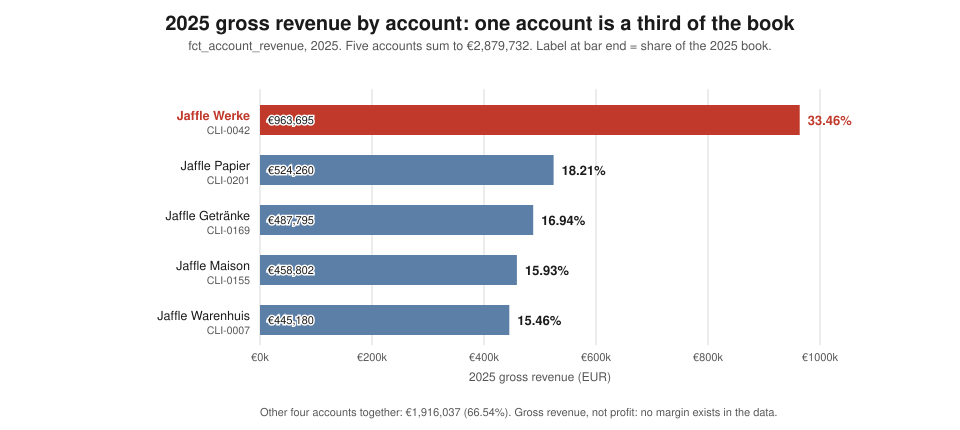
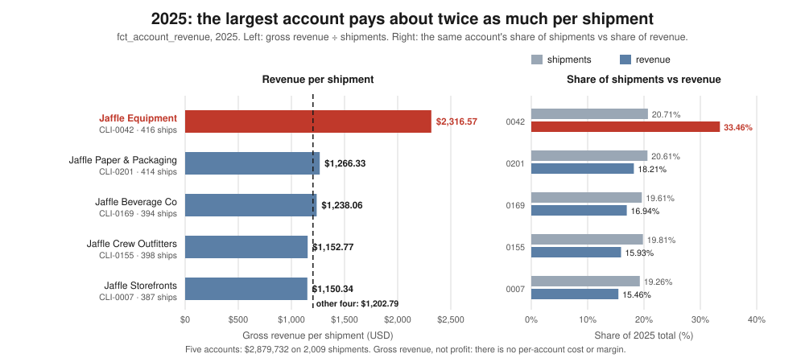
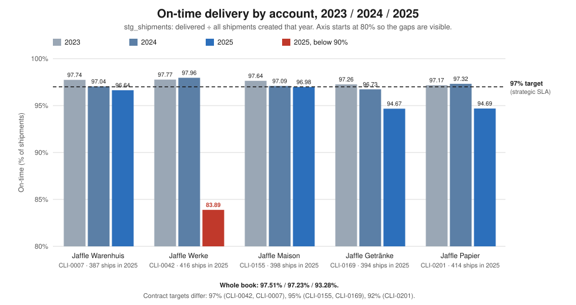

# Company profile: Jaffle Logistics

**Verdict: Jaffle Logistics is a small regional, asset-based carrier. It sells LTL, last-mile and warehousing services to five related accounts from five hubs in five mainland-European countries. Its record shows one strength: two years of roughly 97% on-time delivery under contract. That record broke in 2025. The 2025 book is now one-third a single account, and that account is the one it broke on. The data records no competitor at all.**

*Company profile for a new executive who does not yet know what the company is. The data present runs
to 2025-12-31. 2023 and 2024 are the quiet comparison years. Every figure comes from `execute_sql`
queries run through the dbt Platform remote MCP against `hive_metastore.dbt_smcintyre_jaffle_logistics_prod`
(written `P` below). The SQL is in the appendix, numbered Q1–Q15. Where a number is arithmetic on a
query result, the calculation is in the sentence. Charts are generated by
`scripts/company_profile_charts.py`. **This is a worked example of a fictional company** (`README.md`:
"A fictional logistics company's data"). The repository holds operating data, not market data.*

*Findings note: the platform prod schema has not yet been rebuilt with the European pivot, so it still
returns the old hub ids. The numbers are identical, and the European labels (hubs, cities, accounts,
regions, EUR) come from the re-homed seeds. Every query was re-run against the local pivoted warehouse
(`jaffle_logistics.duckdb`) and reproduced the figures below exactly. The one exception is Q11, whose
vector search and chunk counts need the `knowledge_base` model, which is not built locally (§6). One
arithmetic slip in the earlier version was corrected and is flagged here: it gave the other four
accounts' revenue per shipment as 1,202.78 in §5 and §7 but 1,202.79 elsewhere. Q7 gives
1,916,037 ÷ 1,593 = 1,202.785, which rounds to **€1,202.79**. That figure is now used throughout and
matches the chart.*

---

## 1. The two-minute read

- **What the business is.** A regional freight and delivery operator. It runs five hubs (Paris,
  Amsterdam, Berlin, Vienna, Zürich) with a stated combined capacity of 247,000 packages a
  day (68,000 + 42,000 + 51,000 + 47,000 + 39,000) [Q4]. It has 44 vehicles and 56 drivers [Q5] and ran
  3,629 routes in 2025 [Q4]. It is mostly asset-based, with a growing contracted layer: 23 of its 56
  drivers are contractors, and a subcontractor cost line grew 60.5% in 2025 [Q5, Q12].
- **Who it sells to.** Five accounts on multi-year, auto-renewing contracts, across three lines of
  business: LTL, last-mile and warehousing [Q1, Q2]. 2025 gross revenue was **€2,879,732** [Q6].
- **What its edge is.** Reliability under contract, which is a record, not a moat. In 2023 and 2024
  the whole book ran **97.51%** and **97.23%** on time against a 97% top-tier target [Q8]. Every
  customer since 2020 is still a customer [Q2]. *Inference:* the record is the product. Nothing
  in the data shows a price, network or technology advantage over anyone, because nobody else is in
  the data.
- **What the risk is.** Jaffle Werke (CLI-0042) was **33.46%** of 2025 revenue
  (€963,695 ÷ €2,879,732) on 20.71% of shipments [Q7]. It is flagged `at-risk` [Q1]. It ran
  **83.89%** on time in 2025 against a 97% target [Q8], and it took €51,269 of the €52,954.86 in
  credits issued [Q6]. The book's one big customer is the one the record broke on.
- **What we do not know.** Who the competition is, what the market looks like, or whether any
  account makes money. The corpus names no competitor (zero keyword hits across all 2,307 source records [Q11]).
  It has no margin, no churn or win/loss record, and no renewal calendar. The cost ledger is modelled
  and is about 2.5× revenue (§3).

---

## 2. What the business is

**What it sells.** It sells three lines of business to five accounts [Q1]:

- **LTL:** Jaffle Werke (CLI-0042) and Jaffle Papier (CLI-0201).
- **Last-mile:** Jaffle Warenhuis (CLI-0007) and Jaffle Maison (CLI-0155).
- **Warehousing:** Jaffle Getränke (CLI-0169).

Shipments go at three service levels. In 2025 there were 1,123 standard, 479 freight and 407
expedited, which sums to 2,009 [Q10]. Accounts sit in three tiers: two strategic, two mid, one
small [Q1]. *Inference:* every account is named "Jaffle …". These may be affiliated businesses
rather than arm's-length customers. The data does not say either way.

**How it makes money.** Each account pays monthly. The revenue model splits gross revenue into a
**contracted base** and **accessorial** revenue (columns `contracted_base_revenue` and
`accessorial_revenue` in `fct_account_revenue`; this card does not report the split) [Q6]. Every
contract carries the same penalty clause, verbatim: *"1.0% of monthly spend credited per full
percentage point below the SLA on-time target, capped at 10% of monthly spend"* [Q2]. The targets
differ by account [Q1, Q2]:

| On-time target | Accounts |
|---|---|
| 97.0% | Werke (CLI-0042) and Warenhuis (CLI-0007), the two strategic accounts |
| 95.0% | Maison (CLI-0155) and Getränke (CLI-0169) |
| 92.0% | Papier (CLI-0201) |

The Werke master agreement (`LGL-4000`) runs for an *"initial term of twenty-four (24) months,
auto-renewing for successive twelve (12) month terms"* [Q2].

**Operating model.** The network has five hubs [Q4]:

| Hub | City | Role | Stated capacity (packages/day) |
|---|---|---|---|
| HUB-PAR | Paris | hub | 68,000 |
| HUB-BER | Berlin | warehouse | 51,000 |
| HUB-VIE | Vienna | hub | 47,000 |
| HUB-AMS | Amsterdam | HQ | 42,000 |
| HUB-ZRH | Zürich | hub | 39,000 |

The fleet and the workforce [Q5]:

- **Vehicles: 44.** By type, 21 box trucks, 19 vans and 4 semis. By status, 37 active, 4 in
  maintenance and 3 retired.
- **Drivers: 56.** 33 employees and 23 contractors. By hub: Amsterdam 17, Zürich 13, Paris 10,
  Berlin 9, Vienna 7 (17 + 13 + 10 + 9 + 7 = 56).

Routes ran at 3,338 in 2023, 3,521 in 2024 and 3,629 in 2025 [Q4]. In 2025 those routes made
150,702 stops (30,427 + 30,523 + 29,213 + 30,752 + 29,787). That is **41.53 stops per route**
(150,702 ÷ 3,629). Each hub's average sits between 40.7 and 42.9 [Q4]. Driver pay is a modelled
ledger of €1,841,275.07 in 2025 [Q13]. A separate modelled subcontractor line was €1,186,640 [Q12].

**Asset-based, brokered, or a mix? Mostly asset-based, with a contracted layer.**

- **Asset leg.** It runs 44 vehicles and employs 33 drivers [Q5]. The revenue model has no
  brokerage or resale line, only contracted base and accessorial revenue [Q6].
- **Contracted leg.** 23 of 56 drivers (41.1%) are independent contractors. Their agreements are
  `LGL-9002`, `LGL-4024` and `LGL-4025` [Q3, Q5]. Contractors took €1,017,289.35 of
  €1,841,275.07 in modelled driver pay, which is 55.2% [Q13].
- **Subcontracted leg.** The modelled ledger carries a subcontractor line. It rose from €700,980 in
  2023 to €1,186,640 in 2025 [Q12].
- *Inference:* nothing marks a load as brokered rather than run on Jaffle's own vehicles. "Mix" is
  therefore the honest ceiling. The data does not say whether the vehicles are owned or leased.

**Geography.**

- **Five hubs, five countries.** The hubs are in Paris (France), Amsterdam (the Netherlands),
  Berlin (Germany), Vienna (Austria) and Zürich (Switzerland). `dim_hubs` records the city, not the
  country [Q4]. The country comes from the city name. Zürich is the only hub outside the EU, at the
  Swiss border.
- **Accounts are recorded in four regions:** Noord-Holland ×2 (Warenhuis, Getränke), Île-de-France
  (Werke), Berlin (Maison) and Wien (Papier) [Q1].
- **Mismatch.** Every account region has a hub in it. The Zürich hub has no account in its region.
  (The pivot changed this finding. Under the old US labels, one account had no hub and one hub had
  no account. The underlying rows did not change; only the place names did.)
- **Not recorded:** delivery lanes, destination countries, border crossings, service area, or how
  far beyond the five cities the network reaches. "Region" is one region name per account. It is not
  a coverage map.

---

## 3. How the money works

**The revenue line.** The revenue ledger runs from 2020-01 to 2025-12: 360 rows, which is five
accounts × 72 months [Q6]. This card uses 2023–2025, the years with a shipment record behind them.
Before 2023 the model marks revenue `no_shipment_record`, so the earlier years are imputed rather
than measured [Q6].

| Year | Gross revenue | Change | Credits issued |
|---|---|---|---|
| 2023 | €2,641,286.00 | | €0 |
| 2024 | €2,754,406.50 | +€113,120.50 (+4.28%) | €0 |
| 2025 | €2,879,732.00 | +€125,325.50 (+4.55%) | €52,954.86 (1.84% of gross) |

Source: [Q6].

**The 2025 growth came from one account.** Werke went from €518,805 to €963,695, up €444,890
or 85.8% [Q6]. The other four accounts together went from €2,235,601.50 to €1,916,037, **down
€319,564.50 (−14.3%)** [Q6]. Every one of the four fell:

| Account | 2024 → 2025 |
|---|---|
| Papier | −€96,075 |
| Getränke | −€110,412.50 |
| Maison | −€68,287 |
| Warenhuis | −€44,790 |
| **Total** | **−€319,564.50** |

Werke's shipments rose only from 392 to 416 [Q8]. *Inference:* most of Werke's revenue
jump is price or mix, not volume. It coincides with the new contract CON-0042-02, effective
2025-05-12 [Q2]. The data in this card cannot show why.

**The cost base (modelled ledger, `stg_cost_ledger`).** The ledger has 360 rows: five hubs ×
72 months [Q12].

| 2025 category | € | Share | 2024 → 2025 change |
|---|---|---|---|
| Fuel | 2,855,968 | 39.8% | −665 |
| Facility | 2,595,832 | 36.2% | +36,230 |
| Subcontractor | 1,186,640 | 16.5% | **+447,230** |
| Technology | 273,996 | 3.8% | +3,816 |
| Maintenance | 267,578 | 3.7% | **+163,477** |
| **Total** | **7,180,014** | 100.0% | **+650,088** |

The categories sum to the total: 2,855,968 + 2,595,832 + 1,186,640 + 273,996 + 267,578 =
€7,180,014 [Q12]. Source rows for 2024: [Q12].

Ranked by size, fuel and facility are three-quarters of the base (39.8% + 36.2% = 76.0%). Ranked by
change, two lines explain almost all of 2025's increase:

- Subcontractor: €447,230 of €650,088, or 68.8%.
- Maintenance: €163,477, or 25.1%.

The fleet report (`reports/persona-fleet.md`) already explains the maintenance jump.

**By hub, 2025** [Q12]:

| Hub | Total cost |
|---|---|
| HUB-AMS Amsterdam | €1,745,940 |
| HUB-PAR Paris | €1,393,529 |
| HUB-VIE Vienna | €1,383,006 |
| HUB-ZRH Zürich | €1,372,471 |
| HUB-BER Berlin | €1,285,068 |
| **Sum** | **€7,180,014** |

The hubs sum to the ledger total.

Amsterdam is the outlier, at 24.3% of cost (€1,745,940 ÷ €7,180,014) on 709 of 3,629 routes (19.5%)
[Q4, Q12]:

- **Facility.** Amsterdam carries €688,688 of €2,595,832, or 26.5%. That is €185,414 more than each
  of Paris, Zürich and Vienna (€503,274 each), and 39.4% of Amsterdam's own total
  (€688,688 ÷ €1,745,940).
- **Subcontractors.** Amsterdam also carries €365,715 of the €1,186,640 subcontractor line, or
  30.8%.
- *Inference:* this is the cost of being HQ. Amsterdam also houses the most drivers (17) [Q5].
- **Not separable:** the cost ledger has no customs, border or cross-border line. Whether Zürich's
  €1,372,471 includes any cost of crossing into Switzerland, or what cross-border work costs anywhere
  in the network, cannot be read from this ledger.

**Labour (modelled, `stg_payroll_monthly`)** [Q13]:

| Year | Driver pay | Hours | Overtime hours |
|---|---|---|---|
| 2023 | €1,640,712.90 | 30,042 | 1,120 |
| 2024 | €1,784,066.63 | 31,689 | 1,452 |
| 2025 | €1,841,275.07 | 32,661 | 2,485 |

- **Overtime more than doubled.** 2,485 ÷ 1,120 = 2.22×, while total hours rose 8.7%
  (32,661 ÷ 30,042).
- **Split by employment type, 2025.** Contractors: €1,017,289.35 across 23 drivers, which is
  €44,229.97 each. Employees: €823,985.72 across 33 drivers, which is €24,969.26 each. The two sum to
  €1,841,275.07.
- **Hours are not driving time.** The 2025 overtime jump raises an EU driving-time question
  (Regulation (EC) No 561/2006, recorded by tachograph). The payroll ledger has hours worked and
  overtime, not driving and rest periods, so it cannot show compliance either way.
- **Do not read these as real pay rates.** This is a modelled ledger.

**The blunt arithmetic.** Recorded revenue against modelled cost [Q6, Q12, Q14]:

| Year | Revenue | Modelled cost | Cost ÷ revenue |
|---|---|---|---|
| 2023 | €2,641,286 | €6,424,631 | 2.43× |
| 2024 | €2,754,406.50 | €6,529,926 | 2.37× |
| 2025 | €2,879,732 | €7,180,014 | 2.49× |

**Read that literally and the company loses about €1.50 for every euro it earns. Do not read it
literally.**

- The revenue ledger is real data. The cost ledger and the payroll ledger are both **modelled**.
- The two models were not built to reconcile with each other.
- Driver pay (€1,841,275.07 in 2025) is a **separate** line. It is not inside the cost ledger's
  categories. Do not add it to the cost ledger.
- There is no balance sheet, no P&L, no cash and no margin anywhere in the data.
- **No margin can be computed, for the company or for any account.**

---

## 4. Who the customers are

| Account | Tier | Line | Region | SLA target | Health | 2025 ships | 2025 rev. share | 2025 on-time | 2025 tickets | Standing contract (effective) |
|---|---|---|---|---|---|---|---|---|---|---|
| CLI-0042 Jaffle Werke | strategic | LTL | Île-de-France | 97.0% | **at-risk** | 416 | **33.46%** | **83.89%** | 72 | CON-0042-02 (2025-05-12) |
| CLI-0201 Jaffle Papier | small | LTL | Wien | 92.0% | healthy | 414 | 18.21% | 94.69% | 35 | CON-0201-01 (2024-06-14) |
| CLI-0169 Jaffle Getränke | mid | warehousing | Noord-Holland | 95.0% | watch | 394 | 16.94% | 94.67% | 35 | CON-0169-01 (2024-06-24) |
| CLI-0155 Jaffle Maison | mid | last-mile | Berlin | 95.0% | healthy | 398 | 15.93% | 96.98% | 24 | CON-0155-01 (2023-07-28) |
| CLI-0007 Jaffle Warenhuis | strategic | last-mile | Noord-Holland | 97.0% | healthy | 387 | 15.46% | 96.64% | 23 | CON-0007-01 (2022-04-16) |
| **Total** | | | | | | **2,009** | **100.00%** | **93.28%** | **189** | |

Sources: [Q1] for tier, line, region, SLA, health and contract. [Q7] for shipments and share. [Q8]
for on-time. [Q15] for tickets.

The parts reconcile:

- Shipments: 416 + 414 + 394 + 398 + 387 = 2,009.
- Revenue share: 33.46 + 18.21 + 16.94 + 15.93 + 15.46 = 100.00.
- Tickets: 72 + 35 + 35 + 24 + 23 = 189.

**Jaffle Werke (CLI-0042): the account at risk.**

- **Size.** The biggest account: €963,695 in 2025, a third of the book [Q7].
- **Track record.** It was the most reliable account for two years: 97.77% on time in 2023 and
  97.96% in 2024 [Q8].
- **2025.**
  - It fell to 83.89%: 67 of the year's 135 misses (49.6%) on 20.71% of shipments [Q8].
  - It raised 72 tickets. That is 17.3 per 100 shipments, against 5.9–8.9 for every other account
    [Q15].
  - It took €51,269 in credits, 5.32% of its gross and 96.8% of all credits issued [Q6].
- **Contract.** A new contract, CON-0042-02, took effect on 2025-05-12, in the middle of the collapse
  [Q2].
- **The customer's own words.** The top CRM note calls this the *"first real crack in the
  relationship"*. The customer contact asks *"whether you can actually handle our peak volume"*
  [Q11].
- *Inference:* Werke is the Paris-side account (region Île-de-France). Paris was the worst hub in
  2025, at 88.35% on time with 48 of the 135 misses [Q9].
- The causes are in `reports/where-the-year-was-lost.md`. The revenue exposure is in
  `reports/persona-cro.md`.

**Jaffle Papier (CLI-0201): healthy, under a low bar.**

- The second-largest account by revenue (€524,260, 18.21%) and by shipments (414) [Q7].
- It fell from 97.32% to 94.69% on time [Q8]. Its contract target is only 92%, so it earned **no**
  credits [Q2, Q6].
- In 2023 it was the largest account, with €645,745 (24.45% of €2,641,286) [Q6]. Its revenue has
  fallen two years running: −€25,410, then −€96,075 [Q6].
- Healthy on the contract. Shrinking on the ledger.

**Jaffle Getränke (CLI-0169): on watch.** The only warehousing account. It was 16.94% of 2025
revenue [Q7]. On-time fell to 94.67%, just under its 95% target, which triggered €383.88 in credits
[Q6, Q8]. It raised 35 tickets [Q15]. Revenue fell the most of any account in 2025: −€110,412.50,
from €598,207.50 to €487,795 [Q6]. It is flagged `watch` [Q1]. *Inference:* revenue falling while the
service record weakens is the pattern to check first at renewal.

**Jaffle Maison (CLI-0155): healthy and quiet.**

- Last-mile in Berlin, 15.93% of revenue [Q1, Q7].
- The best 2025 record in the book: 96.98% on time against a 95% target, no credits, and 24 tickets
  [Q6, Q8, Q15].
- Revenue still fell by €68,287 [Q6]. The data cannot say why.

**Jaffle Warenhuis (CLI-0007): the oldest customer.**

- The longest relationship in the record. Its first contract dates from 2020-04-16, which is also
  the date of the earliest source record in the corpus (a legal document) [Q2, Q11].
- Strategic tier, with the same 97% target as Werke [Q1].
- 2025 on-time was 96.64%, just under target, which triggered €1,301.98 in credits [Q6, Q8]. It
  raised the fewest tickets (23) [Q15].
- Renewal of CON-0007-01 for a further 12-month term is confirmed in `LGL-4022` (2024-03-15) [Q3].
- Healthy, but its revenue was the smallest in 2025 (€445,180) [Q7].

---

## 5. Concentration: one account is a third of the book



*What this says: Jaffle Werke brought in €963,695 of the €2,879,732 book (33.46%). The other four
accounts each brought in between 15.46% and 18.21%.*

**Revenue share and shipment share rank the accounts differently** [Q7]:

| Rank | By revenue | By shipments |
|---|---|---|
| 1 | Werke 33.46% | Werke 20.71% |
| 2 | Papier 18.21% | Papier 20.61% |
| 3 | Getränke 16.94% | Maison 19.81% |
| 4 | Maison 15.93% | Getränke 19.61% |
| 5 | Warenhuis 15.46% | Warenhuis 19.26% |

Both columns sum to 100.00 [Q7].

By shipments, the book is almost flat: every account carries between 19.26% and 20.71%. By
revenue, it is not.

**Revenue per shipment, 2025** [Q7]:

| Account | Revenue per shipment |
|---|---|
| Werke | **€2,316.57** |
| Papier | €1,266.33 |
| Getränke | €1,238.06 |
| Maison | €1,152.77 |
| Warenhuis | €1,150.34 |

- The other four together: €1,916,037 ÷ 1,593 shipments = **€1,202.79**. That is
  €2,879,732 − €963,695 of revenue over 2,009 − 416 shipments.
- Werke pays **1.93×** that (€2,316.57 ÷ €1,202.79).
- **This is new.** Werke was 18.78% of revenue in 2023 (€496,025 ÷ €2,641,286) and 18.84% in
  2024 (€518,805 ÷ €2,754,406.50) [Q6].



*What this says: each account ships about a fifth of the volume, but Werke pays €2,316.57 per
shipment against €1,202.79 for the rest of the book. That is how 20.71% of shipments became 33.46%
of revenue.*

**If Werke left,** the book loses its row in [Q7]:

- **Revenue:** €963,695 of gross revenue. 2025 revenue would fall from €2,879,732 to €1,916,037,
  a 33.46% drop.
- **Volume:** 416 of 2,009 shipments, a 20.71% drop.

That is gross revenue and volume, **not profit**. There is no margin figure anywhere in the data
(§3). The data cannot say whether Werke's higher price covers a higher cost to serve. Freight
service ran 86.01% on time against 95.37% for standard [Q10], which hints at harder work.
*Inference:* Werke is an LTL account and may carry much of that freight volume. This card did
not cross-tabulate service level by account.

---

## 6. The competition

**The method.** The original card ran two searches over the governed corpus [Q11]: a keyword scan
of the `knowledge_base` model (2,696 chunks) and a semantic (vector) search for *"competitor
undercutting our price and the customer threatening to leave"*. The local pivoted warehouse has no
`knowledge_base` and no embeddings, so for this rewrite:

- **The keyword scan was re-run over the seven raw source tables** (`stg_dispatch_notes`,
  `stg_incident_reports`, `stg_support_tickets`, `stg_slack_threads`, `stg_call_transcripts`,
  `stg_crm_notes`, `stg_legal_docs`). It looked for the same terms: *competit*, *rival*, *market
  share*, *pricing pressure*, *cheaper* and *carrier*. The records by source: Dispatch Note 1,299,
  Incident Report 357, Support Ticket 403, Slack Thread 116, Call Transcript 55, CRM Notes 56 and
  Legal Document 21. These sum to 2,307 records, dated 2020-04-16 to 2025-12-31. (Records, not
  chunks: incident reports, transcripts, CRM notes and legal documents are split into more than one
  chunk in `knowledge_base`, which is why the old count was 2,696.)
- **The semantic search could not be re-run.** Its ranking and scores need the embeddings. This
  card does not restate the old scores. The passages it surfaced were read directly from the
  sources instead.

**The result.**

- **The keyword scan returned zero hits in every source: 0, 0, 0, 0, 0, 0, 0** [Q11].
- **The passages the semantic search surfaced are account-relationship text, not competition.**
  - `CRM-9001`, a CRM note on CLI-0042 (Jaffle Werke): *"Committed to an SLA credit per contract
    CON-0042-01 and a written recovery plan. Sentiment concerned; first real crack in the
    relationship this year."*
  - `CT-99001`, the same customer on a call on 2025-01-21, about the January Paris storm: *"My
    question is whether you can actually handle our peak volume, because right now I'm not sure."*
  - Neither names another provider.
- **The seed files and legal documents are also clean.** A search of the `seeds/` CSVs found no
  competitor language. No legal document names a competitor, a benchmark, a market share or an
  alternative provider [Q3, Q11].

**The corpus does not record a single competitor, carrier, bid, win/loss or market-share figure.**
As far as this repository knows, there is no market. This card does not invent one.

**What the data does show (fact):**

- All five accounts sign multi-year contracts. The Werke MSA's wording is *"Initial term of
  twenty-four (24) months, auto-renewing for successive twelve (12) month terms"* [Q2].
- Each account's standing contract replaced its original exactly 24 months later [Q2]:

  | Account | Original → replacement |
  |---|---|
  | Warenhuis | 2020-04-16 → 2022-04-16 |
  | Maison | 2021-07-28 → 2023-07-28 |
  | Werke | 2021-11-14 → 2023-11-14 |
  | Papier | 2022-06-14 → 2024-06-14 |
  | Getränke | 2022-06-24 → 2024-06-24 |

  Werke then took a third contract on 2025-05-12, 18 months into the second [Q2].
- Credits are capped at 10% of monthly spend [Q2].
- Targets differ on purpose: 97 / 95 / 92 [Q1].
- Every account signed since 2020 is still on the book in 2025 [Q1, Q6]. No churn or renewal-loss
  record exists in any table or document [Q3, Q11].

**What we infer from that (inference, not fact):**

- Customers have stayed through at least one renewal each. That points to switching costs or
  satisfaction. It does not prove the absence of alternatives.
- The 10% credit cap limits how much a bad year costs the company. The cap works in Jaffle's favour,
  which suggests the contracts were not written under heavy buyer leverage.
- The tiered targets (97 / 95 / 92) look like pricing by service level. *Inference only:* a
  customer accepting a 92% target may be buying on price.
- The standing contracts' effective dates fall in April, May, June (two) and July [Q1]. Jaffle never
  faces the whole book at once.
- None of this tells us who else these customers could buy from, at what price, or whether they
  already split freight with another provider.

**The ceiling.** This repository can say nothing about competitive position. Four things would lift
that ceiling:

1. External market data: lane rates and carrier share in the countries the network serves.
2. A win/loss log of bids.
3. A churn and renewal-outcome table.
4. A competitor or incumbent field on the CRM record.

None of them exists here.

---

## 7. Where the edge is — and where it is not

**1. The reliability record. This is the strongest leg, and it is currently broken.**

- The whole book ran 97.51% on time in 2023 (1,848 shipments) and 97.23% in 2024 (1,949) [Q8].
- In 2023 every account was above 97%.
- In 2024 four of five were above 97%. Getränke ran 96.73%, still above its 95% target.
- No credits were issued in either year [Q6].
- That is a sellable record. Then 2025 came in at **93.28%** on 2,009 shipments: 135 misses, of
  which 109 were delayed, 21 failed and 5 returned [Q8, Q10].
- Without Werke, 2025 still ran **95.73%** (1,525 delivered ÷ 1,593 shipments) [Q8]. That is
  below 97% but above three of the four other accounts' own targets.
- The record is real, but a new customer looking at 2025 would not see it.



*What this says: every account sat close to the 97% line for two years. In 2025 they all slipped,
and Werke fell 14 points, from 97.96% to 83.89%.*

**2. Network density and geography.** Five hubs in five European countries, with 247,000 packages a day
of stated capacity [Q4]. The routes are evenly spread:

- 2025 routes per hub run from 709 to 748. Stops per route run from 40.7 to 42.9 [Q4].
- Dense multi-stop routing (41.53 stops per route) on a van and box-truck fleet (40 of 44
  vehicles) [Q4, Q5] is the shape of regional distribution work.
- The task brief says routes are shared across 1–4 accounts. That figure was not in this card's
  query set, so it is reported as the brief's and was not re-derived.
- *Inference:* density is an edge only against a rival we cannot see. The data does not record
  package volumes against the 247,000 a day, so utilisation and spare capacity cannot be measured.
- A five-country network may also carry a cost. The data records no cross-border volumes or costs,
  so that cannot be measured either.

**3. Contract mechanics.**

- Credits are 1% per point, capped at 10% of monthly spend [Q2].
- The initial term is 24 months, then auto-renewing 12-month terms [Q2].
- An SLA addendum for Werke (`LGL-4021`, 2024-01-30) extends the on-time window by one
  business day for freight tendered from November 15 to December 24 [Q3].
- These terms protect Jaffle. The worst-hit account cost €51,269 in credits on €963,695 of gross
  revenue (5.32%) [Q6].
- *Inference:* this is a commercial cushion, not an operating edge.

**4. Switching cost.** Five accounts across three lines of business, each tied to a hub region [Q1].
The oldest has been on the book since 2020-04-16 [Q2]. *Inference:* warehousing (Getränke) and
last-mile (Warenhuis, Maison) are the hardest to move, because they sit inside the
customer's own operation. The data records no switching attempt either way.

**The counterweight.** Much of what looks like an edge is **one big customer and a contract**.

- Werke is **33.46% of revenue on 20.71% of shipments, at 1.93× the revenue per shipment of the
  rest of the book** (€2,316.57 vs €1,202.79) [Q7].
- Take Werke out, and 2025 revenue is €1,916,037, down 14.3% from the same four accounts'
  2024 total [Q6].
- The contract terms (cap, auto-renewal, peak-season addendum) cushion a bad year. They do not
  create demand.
- The one leg that could create demand, the reliability record, broke in 2025, and it broke worst on
  Werke:
  - 83.89% on time.
  - 72 tickets.
  - A health flag of `at-risk`.
  - A CRM note that calls it the *"first real crack"* [Q1, Q8, Q11, Q15].
- **Today the edge is the 2023–2024 record plus the Werke contract. 2025 has put both in
  question.**

---

## 8. What we would want to know next

1. **Why Werke's revenue jumped 85.8% on 6.1% more shipments.** The split between
   `contracted_base_revenue` and `accessorial_revenue`, plus the CON-0042-02 pricing terms. The split
   exists in `fct_account_revenue`, but it is not in this card's query set.
   *Blocks:* knowing whether a third of the book is durable contracted base or one-off charges.
2. **Cost to serve by account.** Real (not modelled) cost, attributed to accounts.
   *Blocks:* any decision on which account to defend, reprice or let go.
3. **The renewal calendar.** Current term end dates, notice periods and termination rights for each
   standing contract, especially CON-0042-02.
   *Blocks:* a retention plan with dates on it.
4. **A win/loss and churn record, and a competitor field on the CRM.**
   *Blocks:* any statement about market position or price.
5. **Package volumes by hub against stated capacity.**
   *Blocks:* growth decisions, and whether there is room for a new account without new hubs.
6. **Delivery lanes, destination coverage and border crossings.**
   *Blocks:* knowing where the network actually reaches beyond its five cities, how much of it is
   cross-border, and what the Zürich hub, which has no account in its region, actually serves.
7. **Customs and regulatory exposure by country.** Swiss customs volumes, holds and costs at
   Zürich; EC 561/2006 driving-time and tachograph compliance; ADR and Driver CPC certification
   coverage; country-specific rules in the five countries.
   *Blocks:* any statement about compliance risk or the cost of operating across borders.

---

## 9. What we don't know

- **No competitor or market data at all.** There are zero keyword hits across 2,307 source records,
  and no market, carrier or bid record anywhere [Q11]. No external market data (lane rates, carrier
  share by country) is in the repository.
  *Blocks:* pricing strategy and any claim of competitive advantage.
- **The semantic search could not be re-derived.** The local warehouse has no `knowledge_base`
  embeddings, so the vector ranking and scores in the original card were not reproduced [Q11].
  *Blocks:* confirming that no passage closer to "competition" exists in the vector index.
- **No customs or border data.** Swiss customs holds at the Zürich crossing appear in free text
  (23 dispatch notes and 6 incident reports mention customs [Q11]), but there is no table of
  cross-border shipments, customs holds, duties or clearance times.
  *Blocks:* sizing the Swiss customs exposure at Zürich, and any cross-border cost.
- **No regulatory compliance record.** EC 561/2006 driving-time limits, tachograph records, ADR and
  CMR appear in contract and driver text [Q3, Q11], but no table records driving and rest periods,
  infringements, certifications held, or country-specific rules.
  *Blocks:* any statement about EU driving-time compliance or regulatory risk in any country.
- **No margin or account profitability.**
  - Unit cost cannot be attributed to an account. The only exception is modelled maintenance, by
    vehicle and route.
  - The cost ledger is by hub, not by account [Q12].
  - *Blocks:* deciding whether Werke's €2,316.57 per shipment is profitable or just expensive
    to serve.
- **No renewal or termination dates.** We have effective dates and term wording only [Q2, Q3].
  *Blocks:* knowing when each account can actually leave.
- **No churn or win/loss record.** "Every customer stayed" comes from five rows in `dim_clients`,
  not from a churn table [Q1].
  *Blocks:* telling retention strength apart from a book that has simply never been tested.
- **The cost ledger is modelled.** So is driver payroll. Neither reconciles to revenue or to a P&L.
  There is no balance sheet, no cash and no margin [Q12, Q13, Q14].
  *Blocks:* every financial-health question.
- **There is no shipment record before 2023.** Revenue for 2020–2022 is imputed (marked
  `no_shipment_record`), and routes start in 2023 [Q4, Q6].
  *Blocks:* any trend longer than three years.
- **Shipments and stops do not reconcile.** There were 2,009 shipments in 2025 against 150,702 route
  stops [Q4, Q7]. The data does not say how a shipment relates to a stop or a package.
  *Blocks:* unit economics per delivery.
- **The company is fictional.** This is a worked example built to show where exact-match SQL runs
  out of road (`README.md`, `docs/the-problem.md`). The repository's documents hold no company
  history, market position or financial statement.
  *Blocks:* treating any of this as a real business.

---

## Appendix: the queries

`P` = `hive_metastore.dbt_smcintyre_jaffle_logistics_prod`. All were run through the dbt Platform MCP
`execute_sql`. On-time means `status = 'delivered'`. For the European rewrite, Q1, Q3–Q10, Q12, Q13
and Q15 were re-run unchanged (with `P.` dropped) against the local pivoted warehouse
(`jaffle_logistics.duckdb`). Every value matched. The platform schema still returns the old hub ids
until it is rebuilt; the European labels come from the re-homed seeds.

**Q1 — the customer book**
```sql
select client_id, client_name, tier, line_of_business, region, health, contract_id, sla_ontime_pct, contract_effective_date from P.dim_clients
```

**Q2 — contracts.** This comes from the seed `contracts.csv` (11 rows), read as a seed with no
aggregate query. The credit wording, the SLA targets, the effective dates and the `LGL-4000` term
language are quoted from it in the text.

**Q3 — legal documents in force**
```sql
select doc_type, count(*) from P.stg_legal_docs group by doc_type
```

**Q4 — the network**
```sql
select hub_id, city, hub_function, capacity_pkg_day from P.dim_hubs
select year(service_date), count(*) from P.stg_routes group by 1
select hub_id, count(*), sum(stop_count), avg(stop_count) from P.stg_routes where year(service_date)=2025 group by hub_id
```

**Q5 — the fleet and the workforce**
```sql
select vehicle_type, count(*) from P.stg_vehicles group by vehicle_type
select status, count(*) from P.stg_vehicles group by status
select employment_type, count(*) from P.stg_drivers group by employment_type
select hub_id, count(*) from P.stg_drivers group by hub_id
```

**Q6 — revenue by year and account**
```sql
select year(revenue_month), client_id, sum(gross_revenue), sum(credited_amount), sum(shipment_count)
from P.fct_account_revenue where year(revenue_month) >= 2023 group by 1,2
```

**Q7 — concentration, 2025**
```sql
select client_id, sum(gross_revenue), sum(credited_amount), sum(shipment_count),
       round(sum(gross_revenue)/sum(shipment_count),2) as rev_per_shipment
from P.fct_account_revenue where year(revenue_month)=2025 group by client_id
```

**Q8 — reliability by account**
```sql
select year(created_at), client_id, count(*), sum(case when status='delivered' then 1 else 0 end),
       round(100.0*sum(case when status='delivered' then 1 else 0 end)/count(*),2)
from P.stg_shipments group by 1,2
```

**Q9 — reliability by hub**
```sql
select year(created_at), origin_hub_id, count(*), sum(case when status='delivered' then 0 else 1 end),
       round(100.0*sum(case when status='delivered' then 1 else 0 end)/count(*),2)
from P.stg_shipments group by 1,2
```

**Q10 — the 2025 miss mix and service levels**
```sql
select status, count(*) from P.stg_shipments where year(created_at)=2025 group by status
select service_level, count(*), sum(case when status='delivered' then 1 else 0 end)
from P.stg_shipments where year(created_at)=2025 group by service_level
select coalesce(late_bucket,'none'), count(*) from P.stg_shipments where year(created_at)=2025 group by 1
```

**Q11 — the competition scan**
```sql
-- 1) keyword scan of the seven raw sources (local pivoted warehouse; knowledge_base is not built locally).
--    Repeated for stg_incident_reports, stg_support_tickets, stg_slack_threads, stg_call_transcripts,
--    stg_crm_notes and stg_legal_docs.  Result: 2,307 records, 0 hits in every source.
select 'Dispatch Note', count(*), sum(case when lower(body) like '%competit%' or lower(body) like '%rival%'
  or lower(body) like '%market share%' or lower(body) like '%pricing pressure%' or lower(body) like '%cheaper%'
  or lower(body) like '%carrier%' then 1 else 0 end), min(noted_at), max(noted_at)
from stg_dispatch_notes

-- 2) the quoted passages
select note_id, client_id, body from stg_crm_notes where note_id = 'CRM-9001'
select transcript_id, client_id, call_date, body from stg_call_transcripts where transcript_id = 'CT-99001'

-- 3) border and regulation mentions (same seven tables); customs: dispatch 23, incident 6, others 0
select count(*) filter (where lower(body) like '%customs%'),
       count(*) filter (where body like '%561/2006%' or lower(body) like '%tachograph%')
from stg_dispatch_notes

-- original card, platform only, NOT re-derived (needs knowledge_base embeddings):
-- keyword scan over P.knowledge_base (2,696 chunks) and
-- select vector_cosine_similarity(k.embedding, q.v) as score, ... from P.knowledge_base k,
--   (select cast(ai_query('databricks-gte-large-en', '<question>') as array<float>) as v) q
--   order by score desc, k.source_id limit 10
```

**Q12 — the cost base (modelled)**
```sql
select year(cost_month), sum(fuel_cost), sum(maintenance_cost), sum(subcontractor_cost),
       sum(facility_cost), sum(technology_cost), sum(total_cost) from P.stg_cost_ledger
where year(cost_month) >= 2023 group by 1
select hub_id, sum(fuel_cost), sum(maintenance_cost), sum(subcontractor_cost), sum(facility_cost),
       sum(technology_cost), sum(total_cost) from P.stg_cost_ledger where year(cost_month)=2025 group by hub_id
```

**Q13 — the labour picture (modelled)**
```sql
select year(payroll_month), sum(total_cost), sum(hours_worked), sum(overtime_hours)
from P.stg_payroll_monthly where year(payroll_month) >= 2023 group by 1
select employment_type, sum(total_cost), count(distinct driver_id)
from P.stg_payroll_monthly where year(payroll_month)=2025 group by employment_type
```

**Q14 — revenue against modelled cost.** There is no separate query. It is arithmetic on Q6
(revenue) and Q12 (cost). Payroll (Q13) is a separate modelled ledger and is not added in.

**Q15 — service relationship signals, 2025**
```sql
select client_id, sum(shipments), sum(ticket_count), sum(incident_count)
from P.fct_account_health where year(month)=2025 group by client_id
```

---

*The charts are generated by `scripts/company_profile_charts.py` (Python 3, standard library only,
hand-written SVG). Re-running `python3 scripts/company_profile_charts.py` reproduces all three files
in `reports/assets/company/` from the figures embedded in the script. The report itself was authored
by the Claude Code CLI.*
