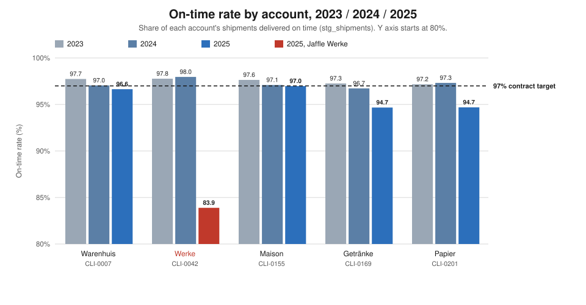
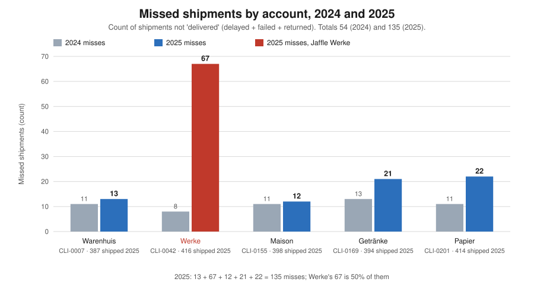
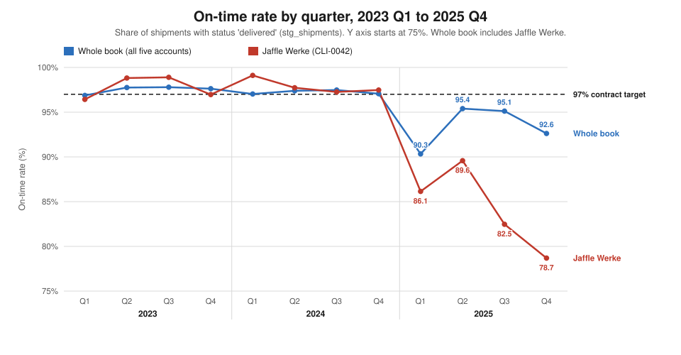
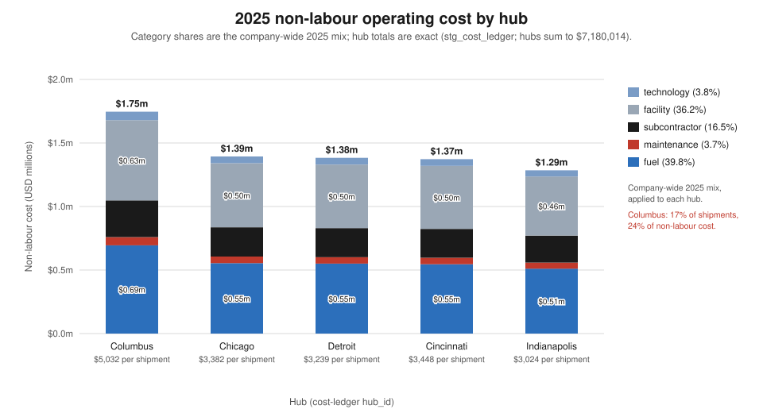
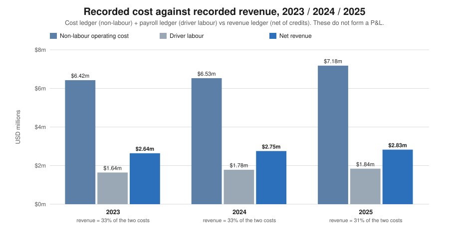
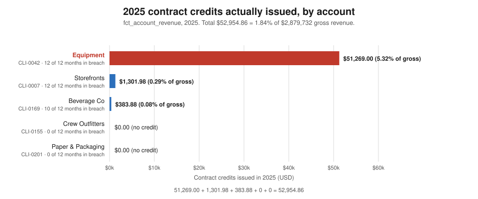
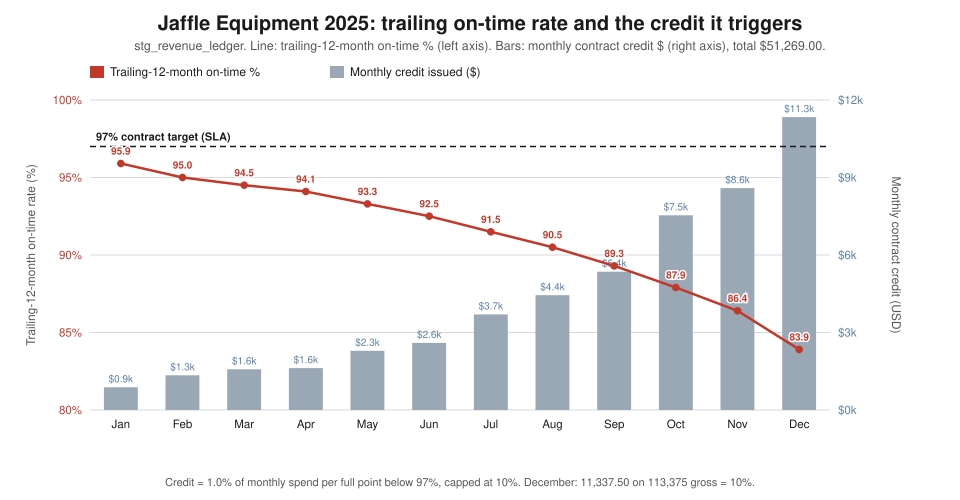
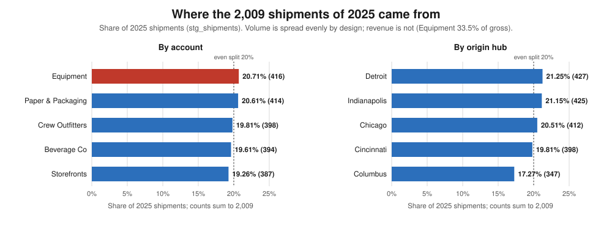

# CFO briefing: the state of the business

**Verdict.** One account broke in 2025, and it cost $51,269.00 in contract credits. The other four are close to target. The bigger problem for this seat is the books: recorded cost is 3.1 times recorded revenue in every year, so there is no margin to report until the two ledgers are reconciled.

- **To:** the incoming CFO
- **From:** Director of Engineering, data platform
- **Data present:** 2025-12-31 (calendar years 2023, 2024 and 2025)
- **Source:** every number was re-derived from queries run through the dbt Platform MCP `execute_sql` against `hive_metastore.dbt_smcintyre_jaffle_logistics_prod`. The SQL is in the appendix, numbered Q1–Q24, and the query number sits beside each figure. Where a number is arithmetic on a query result, the arithmetic is shown.
- **Replaces:** `reports/cfo-arrival-briefing.md`. Read this one instead. Four datasets the old briefing said were missing have since landed: the **revenue ledger**, the **cost ledger**, **payroll**, and the **promised-delivery clock / route attribution**. That changes several of its conclusions (§8).
- **Definitions:** on-time = `status = 'delivered'`. `delayed`, `failed` and `returned` are misses.

## 1. The two-minute read

- **What is fine:** four of five accounts delivered between 94.67% and 96.98% on time in 2025. Without Jaffle Equipment the book ran at 95.73% (1,593 shipments, 68 missed, so 1,525 ÷ 1,593). Two of those four (Crew Outfitters, Paper & Packaging) paid no credits at all (Q4, Q17).
- **What is not:** Jaffle Equipment fell from 97.96% on time in 2024 to 83.89% in 2025. It caused 67 of the book's 135 misses. Its trailing on-time rate fell every month of 2025, from 95.9% to 83.9% (Q4, Q16).
- **What it costs:** $52,954.86 in contract credits in 2025, 1.84% of $2,879,732.00 gross revenue. Jaffle Equipment alone is $51,269.00 of that, 5.32% of its own gross. There were no credits in 2023 or 2024 (Q14, Q17).
- **What is exposed:** Jaffle Equipment is 20.7% of shipments but 33.5% of gross revenue (963,695 ÷ 2,879,732). Its credit hit the 10% monthly cap in November and December, so the credit can grow no further (Q16, Q24).
- **What we do not know:** our margin. Non-labour cost ($7,180,014) plus driver labour ($1,841,275) is $9,021,289, against $2,879,732 of revenue. The ledgers do not describe the same business. We also cannot explain why Jaffle Equipment's revenue rose 86% on 6% more volume (Q13, Q19, Q20).

## 2. What this seat owns

You own margin, cost, the credit exposure written into our contracts, and how concentrated the revenue is. You also own whether the numbers in front of you can be trusted. On the last point, the news is mixed. The warehouse now holds a revenue ledger (`stg_revenue_ledger`, `fct_account_revenue`), a cost ledger (`stg_cost_ledger`), payroll (`stg_payroll_monthly`) and a cost-attribution model (`fct_client_cost_attribution`) (Q1). The dbt semantic layer exposes 10 metrics, including `on_time_rate`, `gross_revenue`, `net_revenue`, `credited_amount` and `credit_rate` (Q2). It cannot express miss counts, hub cuts or the credit arithmetic, so everything below is raw `execute_sql`. The delivery numbers reconcile cleanly. The money numbers reconcile within each ledger, but not with each other (§4.4).

## 3. Where we perform and where we do not

### 3.1 The whole book met the 97% target for two years, then missed it in 2025

| Year | Shipments | Delivered | Missed | On-time | Delayed | Failed | Returned |
|---|---:|---:|---:|---:|---:|---:|---:|
| 2023 | 1,848 | 1,802 | 46 | 97.51% | 37 | 9 | 0 |
| 2024 | 1,949 | 1,895 | 54 | 97.23% | 41 | 10 | 3 |
| 2025 | 2,009 | 1,874 | 135 | 93.28% | 109 | 21 | 5 |

(Q3, Q6.) Each year's three statuses add to its misses; for 2025, 109 + 21 + 5 = 135. Misses rose by 81 in 2025 (135 − 54) on 60 more shipments (2,009 − 1,949). The 97% figure is the target in Storefronts' and Jaffle Equipment's contracts. The other three accounts have lower targets: 95.0%, 95.0% and 92.0% (Q18).

### 3.2 One account collapsed. The others slipped, but stayed near their targets

| Account | 2023 on-time (n / missed) | 2024 | 2025 | 2025 contract target |
|---|---|---|---|---:|
| CLI-0007 Jaffle Storefronts | 97.74% (354 / 8) | 97.04% (371 / 11) | 96.64% (387 / 13) | 97.0% |
| CLI-0042 Jaffle Equipment | 97.77% (359 / 8) | 97.96% (392 / 8) | **83.89% (416 / 67)** | 97.0% |
| CLI-0155 Jaffle Crew Outfitters | 97.64% (382 / 9) | 97.09% (378 / 11) | 96.98% (398 / 12) | 95.0% |
| CLI-0169 Jaffle Beverage Co | 97.26% (329 / 9) | 96.73% (398 / 13) | 94.67% (394 / 21) | 95.0% |
| CLI-0201 Jaffle Paper & Packaging | 97.17% (424 / 12) | 97.32% (410 / 11) | 94.69% (414 / 22) | 92.0% |

(Q4, Q18.) Shipments reconcile in every year: 354 + 359 + 382 + 329 + 424 = 1,848; 371 + 392 + 378 + 398 + 410 = 1,949; 387 + 416 + 398 + 394 + 414 = 2,009. Jaffle Equipment lost 14.07 points in a year (97.96 − 83.89). The other four together went from 46 misses in 2024 (11 + 11 + 13 + 11) to 68 in 2025 (13 + 12 + 21 + 22). That is worse, but it is a different order of problem.



*What this says: every account sat near 97% for two years. In 2025 one red bar fell to 83.9% while the other four stayed between 94.7% and 97.0%.*

### 3.3 By hub, Chicago carries the most misses, but the warehouse data cannot say whose freight they were

| Hub | 2023 (n / missed / on-time) | 2024 | 2025 |
|---|---|---|---|
| HUB-CHI Chicago | 369 / 13 / 96.48% | 420 / 13 / 96.90% | **412 / 48 / 88.35%** |
| HUB-CIN Cincinnati | 379 / 4 / 98.94% | 397 / 13 / 96.73% | 398 / 16 / 95.98% |
| HUB-CMH Columbus | 382 / 8 / 97.91% | 393 / 16 / 95.93% | 347 / 16 / 95.39% |
| HUB-DET Detroit | 332 / 15 / 95.48% | 367 / 7 / 98.09% | 427 / 27 / 93.68% |
| HUB-IND Indianapolis | 386 / 6 / 98.45% | 372 / 5 / 98.66% | 425 / 28 / 93.41% |

(Q5.) 2025 misses by hub sum to the book: 48 + 16 + 16 + 27 + 28 = 135. Chicago's misses went from 13 to 48. This briefing did not run a hub-by-account cut, so I cannot tell you how many of Chicago's 48 were Jaffle Equipment's. Do not read this table as "Chicago is the problem" until that query is run.

### 3.4 The 135 misses, taken apart five ways

All five cuts are counts of the same 135 shipments, so each one sums to 135.



*What this says: four accounts missed roughly one to two dozen shipments each, in both years. Jaffle Equipment went from 8 misses to 67, half the 2025 total.*

- **By account (Q4):** Equipment 67, Paper & Packaging 22, Beverage 21, Storefronts 13, Crew 12. 67 + 22 + 21 + 13 + 12 = 135.
- **By hub (Q5):** Chicago 48, Indianapolis 28, Detroit 27, Cincinnati 16, Columbus 16. Sum 135.
- **By status (Q6):** delayed 109, failed 21, returned 5. Sum 135.
- **By service level (Q8, Q9):** freight 67 (479 shipments, 86.01%), standard 52 (1,123, 95.37%), expedited 16 (407, 96.07%). 67 + 52 + 16 = 135. **This is not an independent finding.** Jaffle Equipment's service level is `freight`, and the 67 freight misses are the same 67 shipments as the Equipment misses. Freight also carries 31 Storefronts and 32 Beverage shipments, all on time. "Freight fails" and "Equipment fails" are one fact, counted once.
- **By how late (Q10, Q11):** lateness is recorded only for `delayed` shipments, from the promised-delivery clock.

| Account | Delayed | Avg hours late | Max | >2 days | 1–2 days | 4–12 h | Failed | Returned | Misses |
|---|---:|---:|---:|---:|---:|---:|---:|---:|---:|
| Jaffle Equipment | 59 | 58.1 | 84 | 55 | 3 | 1 | 8 | 0 | 67 |
| Jaffle Paper & Packaging | 12 | 40.8 | 109 | 2 | 9 | 1 | 8 | 2 | 22 |
| Jaffle Beverage Co | 17 | 62.4 | 132 | 9 | 8 | 0 | 2 | 2 | 21 |
| Jaffle Storefronts | 11 | 46.1 | 113 | 2 | 9 | 0 | 1 | 1 | 13 |
| Jaffle Crew Outfitters | 10 | 53.9 | 119 | 4 | 6 | 0 | 2 | 0 | 12 |
| **Total** | **109** | | | **72** | **35** | **2** | **21** | **5** | **135** |

Delayed shipments sum to 109 (59 + 12 + 17 + 11 + 10). Equipment's late shipments were consistently very late: 55 of its 59 were more than two days late. Beverage's average is higher (62.4 hours), but on 17 shipments. **Gap:** the 26 failed and returned shipments (21 + 5) have no lateness at all. We do not know how long those customers waited, or whether they were ever served.

### 3.5 The whole book against Jaffle Equipment, quarter by quarter



*What this says: both lines tracked the 97% target for eight quarters. In 2025 Equipment fell every quarter but one, ending at 78.69%, and dragged the whole book down with it.*

(Q7.) Equipment's quarterly rate went 86.14% → 89.58% → 82.47% → 78.69% in 2025, on 14, 10, 17 and 26 misses (sum 67). The whole book went 90.33% → 95.40% → 95.12% → 92.62% on 47, 20, 24 and 44 misses (sum 135). 2025 Q1 was bad for everyone: the book missed 47, of which Equipment was 14, so the other four missed 33 (47 − 14). After Q1 the other four recovered and Equipment did not.

### 3.6 Jaffle Equipment's 2025, month by month

The contract measures Equipment against its **trailing 12-month** on-time rate, not the month's own shipments (Q16). That rate fell in every month of 2025:

| Jan | Feb | Mar | Apr | May | Jun | Jul | Aug | Sep | Oct | Nov | Dec |
|---:|---:|---:|---:|---:|---:|---:|---:|---:|---:|---:|---:|
| 95.9 | 95.0 | 94.5 | 94.1 | 93.3 | 92.5 | 91.5 | 90.5 | 89.3 | 87.9 | 86.4 | 83.9 |

It was below the 97% target from the first month. The month's own shipment flag (Q12) is a different view: 76.32% in January (38 shipments, 9 missed), 94.12% in March, 77.55% in December (49 shipments, 11 missed). That is the shipment flag, **not** the rate the credit is paid on. The trailing rate is a smoothed version, so it falls slowly but also recovers slowly. The chart in §5.3 shows the rate and the credit together.

## 4. Where the money goes

Two ledgers feed this section, and they need labels:

- **Non-labour operating cost** is a **modelled ledger line** from `stg_cost_ledger`: fuel, maintenance, subcontractor, facility, technology, by hub and month.
- **Driver labour** is a **modelled ledger line** from `stg_payroll_monthly` (`total_cost`).
- **Cost per route and per shipment** are **proxies** for unit cost. They divide all non-labour cost by a volume count. They do not measure what any particular route or shipment cost.
- **Cost attributed to an account** (`fct_client_cost_attribution`) is a **proxy**. It spreads hub cost by share of stops, which is not the same as the cost of serving that account (§4.3).

### 4.1 Cost by category and by hub

| Non-labour cost (Q19) | 2023 | 2024 | 2025 |
|---|---:|---:|---:|
| Fuel | 2,843,563 | 2,856,633 | 2,855,968 |
| Facility | 2,523,381 | 2,559,602 | 2,595,832 |
| Subcontractor | 700,980 | 739,410 | 1,186,640 |
| Technology | 266,352 | 270,180 | 273,996 |
| Maintenance | 90,355 | 104,101 | 267,578 |
| **Total** | **6,424,631** | **6,529,926** | **7,180,014** |

Each year's five categories sum to its total. Non-labour cost rose $650,088 in 2025 (7,180,014 − 6,529,926). Two lines made 94% of that rise: subcontractor (+447,230) and maintenance (+163,477), together 610,707. Fuel and facility barely moved, and they are three-quarters of the bill: (2,855,968 + 2,595,832) ÷ 7,180,014 = 75.9%. Note that `maintenance_cost` in the cost ledger is a copy of the fleet work-order table, not a second source. The fleet report owns those numbers, and this briefing agrees with its totals.

| 2025, by hub (Q21) | Non-labour cost | Routes | Shipments | $ per route (proxy) | $ per shipment (proxy) | Cost 2024 | Change |
|---|---:|---:|---:|---:|---:|---:|---:|
| Columbus | 1,745,940 | 709 | 347 | 2,463 | 5,032 | 1,462,819 | +283,121 |
| Chicago | 1,393,529 | 748 | 412 | 1,863 | 3,382 | 1,274,687 | +118,842 |
| Detroit | 1,383,006 | 741 | 427 | 1,866 | 3,239 | 1,312,472 | +70,534 |
| Cincinnati | 1,372,471 | 712 | 398 | 1,928 | 3,448 | 1,279,779 | +92,692 |
| Indianapolis | 1,285,068 | 719 | 425 | 1,787 | 3,024 | 1,200,169 | +84,899 |
| **Total** | **7,180,014** | **3,629** | **2,009** | **1,979** | **3,574** | **6,529,926** | **+650,088** |

Hub costs sum to 7,180,014, routes to 3,629 and shipments to 2,009. The hub changes sum to the 650,088 rise. **Columbus is the cost outlier.** It handled 17.27% of 2025 shipments but carried 24.3% of non-labour cost (1,745,940 ÷ 7,180,014). Its proxy cost per shipment, $5,032, is 41% above the company's $3,574 (5,032 ÷ 3,574). It also accounts for 43.6% of the year's cost rise (283,121 ÷ 650,088). It is *not* the delivery outlier: Columbus missed only 16 shipments.



*What this says: four hubs cost about $1.3–1.4m each and Columbus cost $1.75m. Fuel and facility are most of every bar. The category split inside each bar is the company-wide mix, not each hub's own.*

### 4.2 Labour and non-labour

| (Q20) | 2023 | 2024 | 2025 |
|---|---:|---:|---:|
| Non-labour operating cost | 6,424,631 | 6,529,926 | 7,180,014 |
| Driver labour | 1,640,713 | 1,784,067 | 1,841,275 |
| **Total operating cost** | **8,065,344** | **8,313,993** | **9,021,289** |
| Drivers / hours / overtime hours | 47 / 30,042 / 1,120 | 56 / 31,689 / 1,452 | 56 / 32,661 / 2,485 |
| Non-labour $ per route (proxy) | 1,925 (3,338 routes) | 1,855 (3,521) | 1,979 (3,629) |
| Non-labour $ per shipment (proxy) | 3,477 (1,848) | 3,350 (1,949) | 3,574 (2,009) |

Labour is about a fifth of recorded cost: 1,841,275 ÷ 9,021,289 = 20.4% in 2025. It rose $57,208 in 2025 (1,841,275 − 1,784,067) with the same 56 drivers. Overtime hours rose by 1,033 (2,485 − 1,452).

By hub (Q22), 2025 labour sums to 1,841,275: Detroit 437,202, Columbus 384,817, Cincinnati 352,827, Chicago 335,447, Indianapolis 330,982. Detroit has the highest labour cost, and 348,469 of its 437,202 is contractor spend (80%), on 5 contractors and 2 employees. That is an observation about where contractor spend is concentrated. It is not yet a conclusion about whether it is the right mix.

### 4.3 Cost attributed to accounts: a proxy that cannot see the failure

`fct_client_cost_attribution` (Q23) spreads 2025 fleet maintenance across accounts by their share of attributed stops. The allocations sum to 267,578: Paper 63,704, Beverage 55,221, Storefronts 53,135, Crew 52,472, Equipment 43,046. **Jaffle Equipment gets the lowest maintenance allocation and the fewest attributed exceptions of the five** (367, against 478–544 for the others). That does not mean Equipment is cheap to serve. The model spreads the fleet bill. It does not charge the service failure to the account that suffered it. Do not use it for an account-profitability decision.

### 4.4 The blunt arithmetic: recorded cost is three times recorded revenue



*What this says: in every year, net revenue (the blue bar) is about a third of what the two cost ledgers record. These bars cannot be subtracted to give a margin.*

| (Q14, Q19, Q20) | 2023 | 2024 | 2025 |
|---|---:|---:|---:|
| Gross revenue | 2,641,286.00 | 2,754,406.50 | 2,879,732.00 |
| Contract credits | 0.00 | 0.00 | 52,954.86 |
| Net revenue | 2,641,286.00 | 2,754,406.50 | 2,826,777.14 |
| Total operating cost | 8,065,344 | 8,313,993 | 9,021,289 |
| Revenue − cost (gross) | −5,424,058 | −5,559,586 | −6,194,512 |
| Cost ÷ gross revenue | 3.05× | 3.02× | 3.13× |

Taken at face value, the company loses about $5.4–6.2m a year on $2.6–2.9m of revenue, and revenue covers 31–33% of cost. I do not believe that is the business. More likely the ledgers cover different things. Either the cost ledger is hub-level network cost that is not matched to these five accounts' revenue, or the revenue ledger covers only part of the business. **I am not presenting a margin.** A real margin needs both ledgers scoped to the same activity, and a cost-to-serve per account that charges failure where it happens. Neither exists yet (§7, item 1).

## 5. What the failure is worth

### 5.1 The mechanism

Every contract has the same credit rule (Q18):

> "1.0% of monthly spend credited per full percentage point below the SLA on-time target, capped at 10% of monthly spend."

Targets: Storefronts 97.0%, Jaffle Equipment 97.0%, Crew 95.0%, Beverage 95.0%, Paper 92.0%. Jaffle Equipment's current contract `CON-0042-02` took effect 2025-05-12 and kept the 97.0% of its predecessor `CON-0042-01` (2023-11-14), so the target did not change during 2025. Breach is measured on the **trailing 12-month** on-time rate. A month can be in breach while that month's own shipments look acceptable, and the reverse.

### 5.2 The 2025 credits actually issued

| Rank | Account | Months in breach | Gross 2025 | Credits issued | % of gross |
|---:|---|---:|---:|---:|---:|
| 1 | CLI-0042 Jaffle Equipment | 12 of 12 | 963,695.00 | **51,269.00** | 5.32% |
| 2 | CLI-0007 Jaffle Storefronts | 12 of 12 | 445,180.00 | 1,301.98 | 0.29% |
| 3 | CLI-0169 Jaffle Beverage Co | 10 of 12 | 487,795.00 | 383.88 | 0.08% |
| 4 | CLI-0155 Jaffle Crew Outfitters | 0 of 12 | 458,802.00 | 0.00 | — |
| 5 | CLI-0201 Jaffle Paper & Packaging | 0 of 12 | 524,260.00 | 0.00 | — |
| | **Total** | | **2,879,732.00** | **52,954.86** | **1.84%** |

(Q17.) Credits sum: 51,269.00 + 1,301.98 + 383.88 + 0 + 0 = 52,954.86. Gross revenue sums to 2,879,732.00 and net to 2,826,777.14 (Q13). Equipment is 96.8% of all credits paid (51,269.00 ÷ 52,954.86). Storefronts was in breach all year on a 97% target while running 96.64%, but it was never more than a point or so short, so its credits are small.



*What this says: almost all of the money is one account. Equipment's $51,269 is 5.32% of its gross, and the next-largest credit is $1,302.*

### 5.3 How Jaffle Equipment's credit built up

| Month (Q16) | Gross $ | Credit $ | Trailing on-time % | Points below 97 (whole) | Credit % of gross |
|---|---:|---:|---:|---:|---:|
| Jan | 87,925 | 879.25 | 95.9 | 1 | 1% |
| Feb | 67,075 | 1,341.50 | 95.0 | 2 | 2% |
| Mar | 78,790 | 1,575.80 | 94.5 | 2 | 2% |
| Apr | 81,025 | 1,620.50 | 94.1 | 2 | 2% |
| May | 76,350 | 2,290.50 | 93.3 | 3 | 3% |
| Jun | 64,915 | 2,596.60 | 92.5 | 4 | 4% |
| Jul | 74,050 | 3,702.50 | 91.5 | 5 | 5% |
| Aug | 74,050 | 4,443.00 | 90.5 | 6 | 6% |
| Sep | 76,490 | 5,354.30 | 89.3 | 7 | 7% |
| Oct | 83,745 | 7,537.05 | 87.9 | 9 | 9% |
| Nov | 85,905 | 8,590.50 | 86.4 | 10 | 10% (cap) |
| Dec | 113,375 | 11,337.50 | 83.9 | 13 | 10% (cap) |
| **Total** | **963,695** | **51,269.00** | | | **5.32%** |

The credit column is the contract rule applied exactly. For example, October: 97 − 87.9 = 9.1, so 9 whole points, and 9% × 83,745 = 7,537.05. December's trailing rate was 13 whole points under target, so uncapped the credit would have been 13% × 113,375 = 14,738.75. The cap held it to 11,337.50. **From November the cap binds.** Further decline costs no more in credits. It shows up somewhere the credit cannot see.



*What this says: as the trailing rate slid from 95.9% to 83.9%, the monthly credit grew about thirteen-fold, from $879 to $11,338, and hit the 10% cap in the last two months.*

### 5.4 What the credit does not capture

The $51,269 is the contractual price of the failure, not its full cost. It does not include re-delivering or replacing the 8 failed Equipment shipments. It does not include support load: Equipment opened 72 tickets in 2025 against 17 in each of 2023 and 2024, 29 are still open, and its average CSAT was 2.88 out of 5 against 3.86–4.14 for the others (Q24). It does not include anything above the 10% cap. And it says nothing about whether the customer stays, which the warehouse cannot tell us. None of these costs is in a ledger I can query.

## 6. Concentration



*What this says: by volume, no account or hub is more than about 21% of the book. Concentration risk here is a revenue problem, not a volume problem.*

| 2025 (Q24, Q13) | Shipments | Share of shipments | Gross revenue | Share of gross |
|---|---:|---:|---:|---:|
| Jaffle Equipment | 416 | 20.71% | 963,695.00 | 33.5% |
| Jaffle Paper & Packaging | 414 | 20.61% | 524,260.00 | 18.2% |
| Jaffle Crew Outfitters | 398 | 19.81% | 458,802.00 | 15.9% |
| Jaffle Beverage Co | 394 | 19.61% | 487,795.00 | 16.9% |
| Jaffle Storefronts | 387 | 19.26% | 445,180.00 | 15.5% |
| **Total** | **2,009** | **100%** | **2,879,732.00** | **100%** |

Shipments sum to 2,009 and gross to 2,879,732.00. By hub, the 2,009 shipments split Detroit 21.25% (427), Indianapolis 21.15% (425), Chicago 20.51% (412), Cincinnati 19.81% (398) and Columbus 17.27% (347). The hub counts sum to 2,009. Volume is spread evenly **by design** of this dataset, so volume shares tell you little. Revenue is the concentration that matters.

**If the failing account leaves:**

- **Volume:** the book falls by 416 of 2,009 shipments (20.7%), to 1,593.
- **Revenue:** $963,695 gross / $912,426 net leaves, which is 33.5% / 32.3% of the year. What remains is $1,916,037 gross (2,879,732 − 963,695) and $1,914,351.14 net (2,826,777.14 − 912,426.00).
- **Credits:** $51,269.00 of credits go with it, leaving $1,685.86 (52,954.86 − 51,269.00).
- **On-time:** the remaining book ran at 95.73% in 2025 (1,525 ÷ 1,593). That is still below 97%.
- **Cost:** **cannot be said.** The cost ledger is by hub, not account. The only account-level cost is the stop-share attribution proxy (§4.3), and it would say Equipment is the cheapest account to serve. I would not use it to estimate the cost that leaves with an account.

The one-third revenue figure depends on Equipment's 2025 revenue record, which I flag as inconsistent in §8 (correction 7). In 2024 Equipment was 18.8% of gross (518,805 ÷ 2,754,406.50).

## 7. What I would demand in my first 90 days

Ranked. Each item names the missing data and the decision it blocks.

1. **One ledger scope for cost and revenue.** Missing: a statement of what the cost ledger and the revenue ledger each cover, and a mapping between them. Blocks: any margin, any pricing decision, and the annual plan. Recorded cost is 3.1× recorded revenue (§4.4).
2. **An explanation of Jaffle Equipment's 2025 revenue.** Missing: invoice-line detail (base rate, accessorials, rate changes) behind the jump from $518,805 to $963,695 on 6% more shipments. Blocks: every per-account revenue conclusion, the credit base, and the concentration figure in §6.
3. **Root cause of the Equipment / freight failure.** Missing: a hub-by-account cut of the 67 misses, plus route-level causes. Blocks: deciding whether to fix the service, reprice it, or change how we serve it. Until the cap binds, every point of decline costs another 1% of Equipment's monthly spend.
4. **A cost-to-serve per account that charges failure where it happens.** Missing: re-delivery, claims, support handling and exception cost by account. The current attribution spreads cost by stop share. Blocks: account profitability and any decision about which accounts to grow.
5. **Columbus cost detail below category level.** Missing: ledger line items for Columbus, which costs $5,032 per shipment (proxy) against $3,574 company-wide and drove $283,121 of the $650,088 rise. Blocks: the hub cost decision.
6. **Subcontractor spend by hub and lane.** Missing: what the extra $447,230 bought, and where. Blocks: the in-house versus subcontract decision, and the Detroit contractor-mix question (§4.2).
7. **Outcome data for failed and returned shipments.** Missing: lateness or resolution for the 26 failed and returned shipments in 2025. Blocks: an honest measure of how bad the worst service was, and its cost.

## 8. Where this briefing agrees with the last one, and where it does not

The old briefing got the main story right: one account broke in 2025 and drove most of the decline. The following points correct it.

1. **The old briefing's flagship caveat is now wrong (Q3).** It said volumes were identical every year ("2,009 shipments each year"). It called that a simulation artefact that undermined all concentration analysis. The volume-variation work has landed, and volumes are 1,848 (2023), 1,949 (2024) and 2,009 (2025). They are no longer equal. A weaker version of the caveat survives. Volume is still spread evenly by design (each account 19–21% of shipments), while revenue is not (§6). The old sentence should not be repeated.
2. **Miss counts changed with the volumes (Q3).** The old briefing said 50 misses in 2023 and 56 in 2024. They are **46** and **54**. The 2024 whole-book on-time rate is **97.23%**, not 97.21%.
3. **Jaffle Equipment's quiet-year rate was stale (Q4).** The old briefing said Equipment ran at 98.07% in both 2023 and 2024. It ran at **97.77% (2023)** and **97.96% (2024)**. The 2025 collapse to 83.89% and the conclusion are unaffected. The decline from 2023 is 13.9 points (97.77 − 83.89), not 14.2 (98.07 − 83.89).
4. **The central limitation no longer holds (Q14, Q18).** The old briefing said "there is no revenue table, no payroll, no promised-delivery date, and cost cannot be attributed to an account at all". All four have since landed. This briefing therefore **replaces a percentage exposure with a dollar figure**. The 2025 contract credits actually issued to Jaffle Equipment are **$51,269.00**, 5.32% of its gross revenue. Do not carry forward the old "152% of one month's spend" framing.
5. **January and August maintenance were crash bills, not planned peaks (Q21).** The old briefing read them as "planned peaks rather than a steady drift". The fleet report showed January was 96% collision repair and August 72%. This briefing agrees with the fleet report and withdraws the "planned peaks" reading.
6. **New, and the CFO's own problem: the two ledgers do not produce a plausible P&L (Q20, Q24).** Non-labour operating cost of $7,180,014 plus driver labour of $1,841,275 is $9,021,289, against revenue of $2,879,732. Recorded cost is 3.1 times recorded revenue (9,021,289 ÷ 2,879,732), and the ratio is about the same in 2023 (3.05×) and 2024 (3.02×). Either the cost ledger is hub-level network cost that is not matched to these five accounts' revenue, or the revenue ledger covers only part of the business. This briefing states the arithmetic and names the gap. It does not present a margin.
7. **New: Jaffle Equipment's revenue moved the wrong way for the story it is in (Q17).** Its 2025 gross revenue rose 86% ($518,805 → $963,695; 963,695 ÷ 518,805 = 1.86) on a 6% volume rise (392 → 416 shipments). Its revenue per shipment ($2,316.57) is nearly double every other account's ($1,150.34–$1,266.33). In 2023 and 2024 every account sat between $1,298 and $1,523 per shipment (Q15). Either its pricing or its revenue record is inconsistent with the other four accounts. Treat this as an inconsistency to investigate, **not** a business result. It weakens every per-account revenue conclusion in this briefing, including the 33.5% concentration figure.
8. **Fleet maintenance totals (Q19).** The old briefing's maintenance and cost-per-unit figures belong to the fleet report. This briefing agrees with its totals ($90,355 / $104,101 / $267,578) and does not re-argue them.

## 9. What the data cannot tell you

- **Margin, EBITDA or profit, at company or account level.** The two ledgers are not scoped to the same activity (§4.4). Blocks: pricing, budget, and any "is this account worth keeping" decision.
- **The cost of serving any one account.** Cost is recorded by hub. The account attribution is a stop-share proxy that does not charge failure to the failing account (§4.3). Blocks: account profitability and the cost side of the "if Equipment leaves" case.
- **Whether Jaffle Equipment's revenue record is right.** Its revenue per shipment is out of line with every other account (§8, item 7). Blocks: trusting the credit base and the concentration figure.
- **How late the failed and returned shipments were.** 21 failed and 5 returned in 2025, with no lateness measured. Blocks: knowing the true severity of the worst service.
- **The cost of failure beyond the contract credit.** Re-delivery, claims and support handling are not in any ledger. Blocks: the real price of the Equipment problem.
- **Customer intent, renewal likelihood, competitor behaviour, insurance.** None of this is in the warehouse. Blocks: any revenue-at-risk forecast. §6 shows only what leaves *if* an account leaves, not how likely that is.
- **Which hub's operations caused Equipment's misses.** No hub-by-account cut was run for this briefing. Blocks: assigning the fix to an operations team.

## Appendix: the queries

`P` stands for `hive_metastore.dbt_smcintyre_jaffle_logistics_prod`. Counts come back as strings and were parsed. Every derived figure in the report is arithmetic on these outputs.

**Q1.** `SHOW TABLES IN hive_metastore.dbt_smcintyre_jaffle_logistics_prod;`

**Q2.** Semantic layer: `list_metrics` through the dbt Platform MCP (10 metrics: `on_time_rate`, `on_time_shipments`, `shipments`, `on_time_rate_change_vs_prior_quarter_pts`, `late_hours`, `gross_revenue`, `net_revenue`, `credited_amount`, `credit_rate`, `accessorial_revenue`).

**Q3.** Whole-book on-time by year:
```sql
SELECT year(created_at) yr, count(*) n,
       sum(case when status='delivered' then 1 else 0 end) delivered,
       sum(case when status<>'delivered' then 1 else 0 end) missed,
       round(100.0*sum(case when status='delivered' then 1 else 0 end)/count(*),2) ontime_pct
FROM P.stg_shipments GROUP BY 1 ORDER BY 1;
```

**Q4.** On-time and misses by account by year:
```sql
SELECT c.client_id, c.client_name, year(s.created_at) yr, count(*) n,
       sum(case when s.status='delivered' then 1 else 0 end) delivered,
       sum(case when s.status<>'delivered' then 1 else 0 end) missed,
       round(100.0*sum(case when s.status='delivered' then 1 else 0 end)/count(*),2) ontime_pct
FROM P.stg_shipments s JOIN P.dim_clients c ON c.client_id=s.client_id
GROUP BY 1,2,3 ORDER BY 1,3;
```

**Q5.** On-time and misses by hub by year:
```sql
SELECT h.hub_id, h.city, year(s.created_at) yr, count(*) n,
       sum(case when s.status<>'delivered' then 1 else 0 end) missed,
       round(100.0*sum(case when s.status='delivered' then 1 else 0 end)/count(*),2) ontime_pct
FROM P.stg_shipments s JOIN P.dim_hubs h ON h.hub_id=s.origin_hub_id
GROUP BY 1,2,3 ORDER BY 1,3;
```

**Q6.** Status mix by year:
```sql
SELECT year(created_at) yr, status, count(*) n FROM P.stg_shipments GROUP BY 1,2 ORDER BY 1,2;
```

**Q7.** Quarterly whole book and Jaffle Equipment:
```sql
SELECT concat(cast(year(created_at) as string),'-Q',cast(quarter(created_at) as string)) q,
       count(*) n, sum(case when status<>'delivered' then 1 else 0 end) missed,
       round(100.0*sum(case when status='delivered' then 1 else 0 end)/count(*),2) overall_pct,
       round(100.0*sum(case when status='delivered' and client_id='CLI-0042' then 1 else 0 end)
             /nullif(sum(case when client_id='CLI-0042' then 1 else 0 end),0),2) equip_pct,
       sum(case when client_id='CLI-0042' and status<>'delivered' then 1 else 0 end) equip_missed
FROM P.stg_shipments GROUP BY 1 ORDER BY 1;
```

**Q8.** Service-level mix, 2025 (whole book):
```sql
SELECT service_level, count(*) n,
       sum(case when status='delivered' then 1 else 0 end) delivered,
       sum(case when status<>'delivered' then 1 else 0 end) missed,
       round(100.0*sum(case when status='delivered' then 1 else 0 end)/count(*),2) ontime_pct
FROM P.stg_shipments WHERE year(created_at)=2025 GROUP BY 1 ORDER BY 1;
```

**Q9.** Service level x account, 2025 (shows freight = Jaffle Equipment):
```sql
SELECT service_level, client_id, count(*) n,
       round(100.0*sum(case when status='delivered' then 1 else 0 end)/count(*),2) ontime_pct
FROM P.stg_shipments WHERE year(created_at)=2025 GROUP BY 1,2 ORDER BY 1,2;
```

**Q10.** How late the late ones were, by account, 2025:
```sql
SELECT client_id, status, count(*) n, round(avg(hours_late),1) avg_hours_late,
       max(hours_late) max_hours_late
FROM P.stg_shipments
WHERE year(created_at)=2025 AND status<>'delivered' GROUP BY 1,2 ORDER BY 1,2;
```

**Q11.** Lateness buckets, by account, 2025:
```sql
SELECT client_id, late_bucket, count(*) n
FROM P.stg_shipments WHERE year(created_at)=2025 GROUP BY 1,2 ORDER BY 1,2;
```

**Q12.** Jaffle Equipment monthly 2025 (shipment flag):
```sql
SELECT month(created_at) m, count(*) n,
       sum(case when status<>'delivered' then 1 else 0 end) missed,
       round(100.0*sum(case when status='delivered' then 1 else 0 end)/count(*),2) ontime_pct
FROM P.stg_shipments WHERE year(created_at)=2025 AND client_id='CLI-0042' GROUP BY 1 ORDER BY 1;
```

**Q13.** Revenue and credits by account by year:
```sql
SELECT client_id, year(revenue_month) yr,
       round(sum(contracted_base_revenue+accessorial_revenue),2) gross_rev,
       round(sum(credited_amount),2) credits, round(sum(net_revenue),2) net_rev,
       sum(invoice_count) invoices, sum(shipment_count) shipments
FROM P.stg_revenue_ledger WHERE year(revenue_month) between 2023 and 2025
GROUP BY 1,2 ORDER BY 1,2;
```

**Q14.** Ledger totals by year (revenue, credits, net):
```sql
SELECT year(revenue_month) yr, round(sum(contracted_base_revenue+accessorial_revenue),2) gross_rev,
       round(sum(credited_amount),2) credits, round(sum(net_revenue),2) net_rev
FROM P.stg_revenue_ledger GROUP BY 1 ORDER BY 1;
```

**Q15.** Revenue per shipment by account by year:
```sql
SELECT client_id, year(revenue_month) yr, sum(shipment_count) shipments,
       round(sum(contracted_base_revenue+accessorial_revenue)/sum(shipment_count),2) rev_per_shipment
FROM P.stg_revenue_ledger WHERE year(revenue_month) between 2023 and 2025 GROUP BY 1,2 ORDER BY 1,2;
```

**Q16.** Jaffle Equipment monthly 2025 (trailing on-time rate and the credit it drives):
```sql
SELECT month(revenue_month) m, round(contracted_base_revenue+accessorial_revenue,2) gross_rev,
       round(credited_amount,2) credits, round(trailing_12m_ontime_pct,2) trailing_ontime,
       sla_ontime_pct, measurement_basis
FROM P.stg_revenue_ledger WHERE client_id='CLI-0042' AND year(revenue_month)=2025 ORDER BY m;
```

**Q17.** 2025 revenue, credits and breach months by account:
```sql
SELECT client_id, count(*) months,
       sum(case when ontime_vs_target < 0 then 1 else 0 end) months_in_breach,
       round(sum(gross_revenue),2) gross_rev, round(sum(credited_amount),2) credits_paid,
       round(100.0*sum(credited_amount)/sum(gross_revenue),2) credit_pct_of_gross
FROM P.fct_account_revenue WHERE year(revenue_month)=2025 GROUP BY 1 ORDER BY credits_paid DESC;
```

**Q18.** Contracts (SLA targets and credit terms):
```sql
SELECT contract_id, client_id, effective_date, sla_ontime_pct, credit_terms
FROM P.stg_contracts ORDER BY client_id, effective_date;
```

**Q19.** Cost by category by year (non-labour ledger):
```sql
SELECT year(cost_month) yr, sum(fuel_cost) fuel, sum(maintenance_cost) maint,
       sum(subcontractor_cost) subc, sum(facility_cost) facility,
       sum(technology_cost) tech, sum(total_cost) total
FROM P.stg_cost_ledger WHERE year(cost_month) between 2023 and 2025 GROUP BY 1 ORDER BY 1;
```

**Q20.** Cost labour and non-labour, by year, against revenue:
```sql
SELECT year(payroll_month) yr, round(sum(total_cost),0) labour_cost, count(distinct driver_id) drivers,
       round(sum(hours_worked),0) hours, round(sum(overtime_hours),0) ot_hours
FROM P.stg_payroll_monthly WHERE year(payroll_month) between 2023 and 2025 GROUP BY 1 ORDER BY 1;

SELECT y.yr, y.cost, r.routes, s.shipments, round(y.cost/r.routes,0) cost_per_route,
       round(y.cost/s.shipments,0) cost_per_shipment
FROM (SELECT year(cost_month) yr, sum(total_cost) cost FROM P.stg_cost_ledger GROUP BY 1) y
JOIN (SELECT year(service_date) yr, count(*) routes FROM P.stg_routes GROUP BY 1) r ON r.yr=y.yr
JOIN (SELECT year(created_at) yr, count(*) shipments FROM P.stg_shipments GROUP BY 1) s ON s.yr=y.yr
WHERE y.yr between 2023 and 2025 ORDER BY 1;
```

**Q21.** Cost by hub by year, with 2025 volume and unit cost:
```sql
SELECT year(cost_month) yr, hub_id, sum(total_cost) total_cost
FROM P.stg_cost_ledger WHERE year(cost_month) between 2023 and 2025 GROUP BY 1,2 ORDER BY 1,2;

SELECT c.hub_id, r.routes, s.shipments, round(c.total_cost,0) total_cost,
       round(c.total_cost/r.routes,0) cost_per_route, round(c.total_cost/s.shipments,0) cost_per_shipment
FROM (SELECT hub_id, sum(total_cost) total_cost FROM P.stg_cost_ledger WHERE year(cost_month)=2025 GROUP BY 1) c
JOIN (SELECT hub_id, count(*) routes FROM P.stg_routes WHERE year(service_date)=2025 GROUP BY 1) r ON r.hub_id=c.hub_id
JOIN (SELECT origin_hub_id hub_id, count(*) shipments FROM P.stg_shipments WHERE year(created_at)=2025 GROUP BY 1) s ON s.hub_id=c.hub_id
ORDER BY c.hub_id;
```

**Q22.** Payroll 2025 by hub and employment type:
```sql
SELECT hub_id, employment_type, count(distinct driver_id) drivers, round(sum(hours_worked),0) hours,
       round(sum(gross_pay),0) gross_pay, round(sum(total_cost),0) total_cost,
       round(sum(overtime_hours),0) ot_hours
FROM P.stg_payroll_monthly WHERE year(payroll_month)=2025 GROUP BY 1,2 ORDER BY 1,2;
```

**Q23.** Cost attribution to accounts, 2025:
```sql
SELECT client_id, sum(shipment_count) shipments, round(sum(allocated_maintenance_cost),0) allocated_maint,
       round(sum(attributed_exceptions),0) attributed_exceptions, round(sum(route_count),0) routes,
       round(sum(gross_revenue),0) gross_rev, round(sum(net_revenue),0) net_rev
FROM P.fct_client_cost_attribution WHERE year(month)=2025 GROUP BY 1 ORDER BY allocated_maint DESC;
```

**Q24.** Concentration, tickets and incidents:
```sql
SELECT client_id, count(*) shipments, round(100.0*count(*)/sum(count(*)) over (),2) pct_of_book
FROM P.stg_shipments WHERE year(created_at)=2025 GROUP BY 1 ORDER BY 2 DESC;

SELECT origin_hub_id hub_id, count(*) shipments, round(100.0*count(*)/sum(count(*)) over (),2) pct_of_book
FROM P.stg_shipments WHERE year(created_at)=2025 GROUP BY 1 ORDER BY 2 DESC;

SELECT client_id, year(opened_at) yr, count(*) tickets,
       sum(case when status in ('open','pending') then 1 else 0 end) open_now,
       round(avg(csat),2) avg_csat
FROM P.stg_support_tickets GROUP BY 1,2 ORDER BY 1,2;

SELECT year(occurred_at) yr, incident_type, count(*) n,
       sum(case when cast(severity as int)>=3 then 1 else 0 end) sev3plus
FROM P.stg_incidents GROUP BY 1,2 ORDER BY 1,2;

SELECT incident_type, hub_id, count(*) n
FROM P.stg_incidents WHERE year(occurred_at)=2025 GROUP BY 1,2 ORDER BY 1,2;
```

---

*The eight charts in this briefing are generated by `scripts/persona_cfo_charts.py` (standard-library Python 3, hand-written SVG) from the figures above, and are written to `reports/assets/personas/cfo-*.svg`. They are reproducible by re-running `python3 scripts/persona_cfo_charts.py` from the repo root.*
