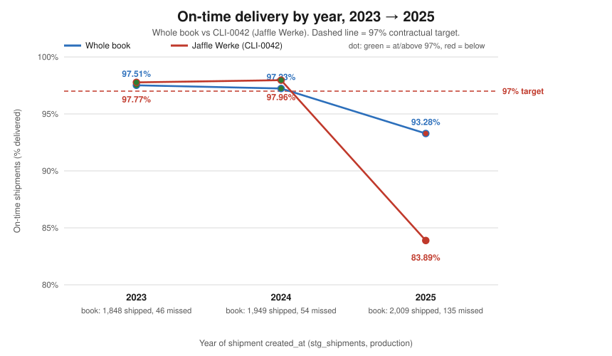
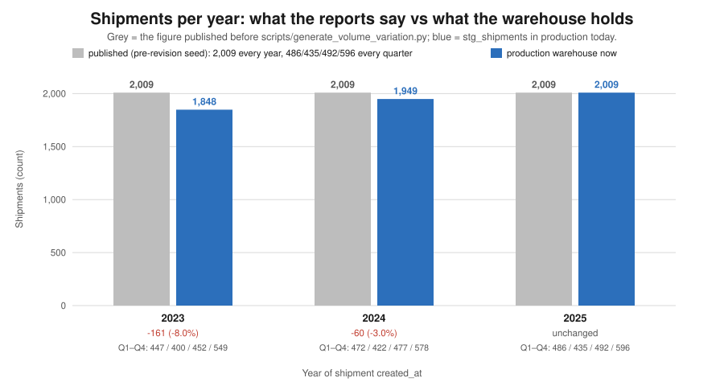
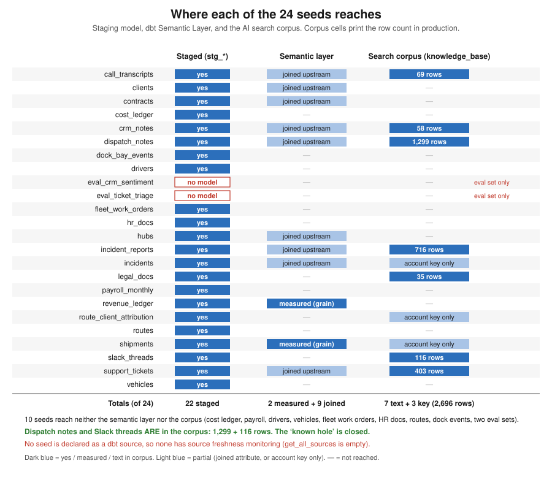
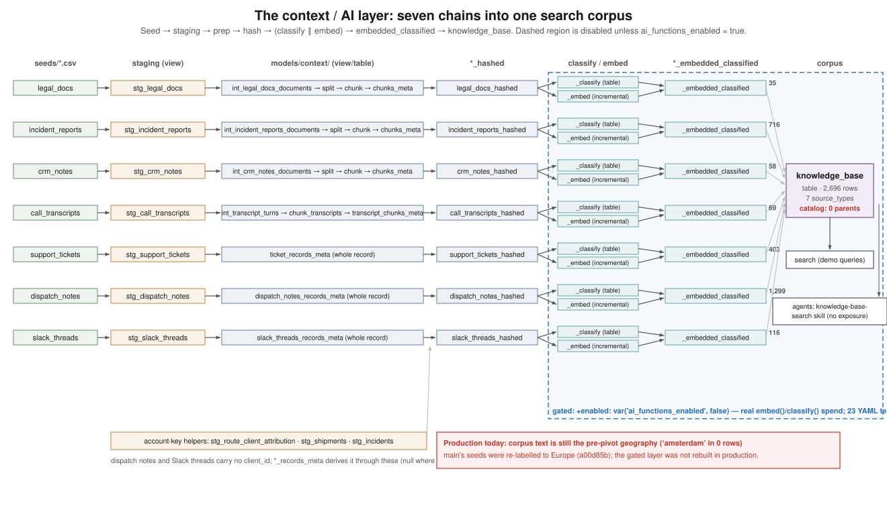
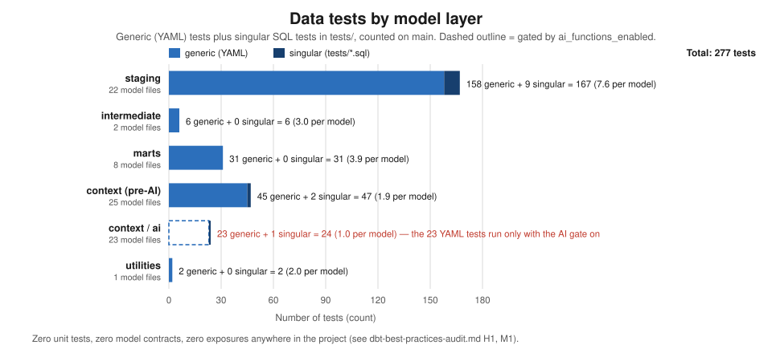

# Head of Data: can we trust the warehouse?

*Persona report: Head of Data / Analytics. Dataset present: 2025-12-31. First written 2026-10-10 against
production (`hive_metastore.dbt_smcintyre_jaffle_logistics_prod`) and `main` at `5056c55`. Re-issued for
the European labels: every warehouse number below was re-derived against a local build of `main`; the
production figures that could not be re-queried (the search corpus, the platform's labels, the
Semantic Layer calls) are marked as such. Charts are regenerated by
`python3 scripts/persona_data_charts.py`.*

## 1. The two-minute read

- **What is fine.** The headline numbers are solid. The whole-book on-time rate (97.51% → 97.23% →
  **93.28%**), the CLI-0042 collapse (97.96% → **83.89%**), the 2025 miss count (**135**), the damage
  cluster (7 → 8 → **40** incidents) and ticket volumes (107 → 107 → **189**) all re-run identically on a
  build of `main` and add up. The search corpus *does* include dispatch notes and Slack threads
  (1,299 + 116 rows), so the "known hole" in the corpus is **closed**.
- **What is not.** Two things shifted under the reports. (1) **Volumes:** the "identical 2,009 shipments
  every year" that two early reports relied on was partly repaired. The warehouse holds **1,848 / 1,949 /
  2,009**. Both reports have since been re-issued with the new figures. (2) **Names:** `main` was
  relabelled to a European carrier (commit `a00d85b`). A plain `dbt build` of `main` is green (24 seeds,
  59 models, 256 tests passing), so `main` *does* reproduce from seed to warehouse, except for the gated
  AI layer. Production has not been rebuilt and still carries the pre-pivot US place and client labels.
- **What it costs.** No headline conclusion falls. The sentences that went stale — 2023–24 miss counts
  (50/56 → **46/54**), the 2024 rate (97.21% → **97.23%**), CLI-0042's quiet-year rate (98.07% →
  **97.77% / 97.96%**) and "zero volume effect" (it is ~2%, not zero) — are corrected in the re-issued
  reports. Anyone quoting an older copy is quoting stale data.
- **What is exposed.** The reports now use the European names, and so does `main`. Production does not.
  Until production is rebuilt from `main`, including the gated AI build, the reports and the warehouse
  that agents query disagree on every hub and client name, and the AI search corpus keeps answering with
  pre-pivot text. Nothing tests for this.
- **What we do not know.** Whether the semantic layer answers correctly for 2023: its time spine starts
  on 2024-01-01. Whether the AI layer builds from `main`, because no one has run it. And whether any of
  this behaves like a real carrier: **the dataset is simulated end to end.**

## 2. What this seat owns

The Head of Data owns the platform's word: the seeds, the dbt models that turn them into tables, the
tests that guard those tables, the semantic layer (the governed metric definitions) and the AI search
corpus (`knowledge_base`) that agents query. This report doesn't ask how the business did. Five reports
answered that (`where-the-year-was-lost.md`, `what-did-we-know-and-when.md`,
`amsterdam-damage-forensics.md`, `cfo-arrival-briefing.md` and the persona reports). It asks whether you
can believe what they say, which numbers bear the load, and what would break that trust. It builds on the
technical audit in `dbt-best-practices-audit.md` and doesn't repeat it.

## 3. Findings

### Finding 1: The headline numbers verify. Two families of figures went stale under the reports.

**Trust register.** These are the figures the other reports rely on, re-checked for this re-issue.
*Verified by query* means a query below returns this number now. *Corrected* means the first-published
number was wrong against the current warehouse and the re-issued report now carries the right one.
*Artefact-prone* means the number is right today but rests on something that changed, or will change.
*Unsupported* means no query supports the published number.

| # | Figure as first published | Where | Warehouse today | Status | Query |
|---|---|---|---|---|---|
| T1 | Whole-book on-time 2023 = 97.51% | where-the-year-was-lost; CFO briefing | 97.51% | **verified by query** | Q1 |
| T2 | Whole-book on-time 2024 = **97.21%** | where-the-year-was-lost; CFO briefing | **97.23%** | **corrected** in both re-issues | Q1 |
| T3 | Whole-book on-time 2025 = 93.28%, 135 of 2,009 missed | all reports | 93.28%; 109 + 21 + 5 = 135 of 2,009 | **verified by query** | Q1 |
| T4 | Misses 2023 / 2024 = **50 / 56** | where-the-year-was-lost; CFO briefing | **46 / 54** | **corrected** in both re-issues | Q1 |
| T5 | Shipments "2,009 every year", "486/435/492/596 every quarter" | where-the-year-was-lost; CFO briefing | 1,848 / 1,949 / 2,009 | **corrected** in both re-issues: *the volume artefact* (Finding 2) | Q1, Q3 |
| T6 | CLI-0042 2025 on-time = 83.89% | all reports | 83.89% (416 shipments) | **verified by query** | Q2 |
| T7 | CLI-0042 quiet years = **98.07%** both years | where-the-year-was-lost | **97.77% / 97.96%** | **corrected** in the re-issue | Q2 |
| T8 | Damage incidents 7 → 8 → 40 | persona-fleet; forensics | 7 / 8 / 40 | **verified by query** | Q4 |
| T9 | Total incidents 100 / 110 / 174 | persona-coo | 100 / 110 / 174 | **verified by query** | Q4 |
| T10 | HQ-hub damage per 100 routes on 712 / 684 / 709 routes ("7.6× rise") | damage forensics | 666 / 666 / 709 routes; 0.30 / 0.30 / 2.12 per 100; about 7× | **corrected** in the re-issued `amsterdam-damage-forensics.md` | Q6 |
| T11 | Support tickets 107 / 107 / 189 | persona-cro; CFO briefing | 107 / 107 / 189 | **verified by query**; the identical 2023–24 counts are a second flat spot to treat with care | Q5 |
| T12 | Routes 3,338 / 3,521 / 3,629 | company-profile; persona-fleet; persona-coo | 3,338 / 3,521 / 3,629 | **verified by query** | Q6 |
| T13 | Hub and client *names* | every report | European names on `main` and in its build; pre-pivot US names in production | **artefact-prone**: re-issued reports match `main` and contradict production until it is rebuilt (Finding 3) | Q11a–c |
| T14 | Search corpus excludes dispatch notes and Slack | task card | both included: 1,299 + 116 rows | **unsupported**: the claim is false (Finding 4) | Q8, Q12 |

*Arithmetic.* T3: 1,874 + 109 + 21 + 5 = 2,009. T4: misses = delayed + failed + returned:
2023 37 + 9 + 0 = 46; 2024 41 + 10 + 3 = 54; 2025 109 + 21 + 5 = 135. T6/T7: 97.96 − 83.89 =
**14.07 points** lost in a year. T8–T9: 100 + 110 + 174 = 384 = `stg_incidents` rows (Q7). T11:
107 + 107 + 189 = 403 = `stg_support_tickets` rows (Q7). T12: 3,338 + 3,521 + 3,629 = 10,488 =
`stg_routes` rows (Q7).



*What this says: the whole book was at or above the 97% target in 2023 and 2024 and fell to 93.28% in
2025, and almost all of the fall belongs to one account.*

### Finding 2: The volume artefact: a headline figure was partly repaired after the reports were published, and two reports went stale until their re-issue

**What happened.** The seeds were first generated so that **2023, 2024 and 2025 each held exactly 2,009
shipments and 3,629 routes**, identical in every quarter. `where-the-year-was-lost.md` took this at face
value and made it a load-bearing caveat. Its §1 says the warehouse "holds **identical shipment volumes**",
and its §4 says "Shipment volume is *identical* in every year at every quarter … The whole-book shortfall
therefore contains **zero volume effect**". `cfo-arrival-briefing.md` (l.237–241) built its concentration
caveat on the same identity: "the year-over-year volumes are identical (2,009 shipments every year)".

**It was then partly repaired.** `scripts/generate_volume_variation.py` (commit `c1c3143`, 2026-10-10
10:56) is a one-off *revision* that rewrites `seeds/shipments.csv` and `seeds/routes.csv` in place. In its
own words: *"before this revision 2023, 2024 and 2025 each held exactly 2,009 shipments and 3,629 routes,
so no analysis could separate a volume effect from a reliability effect."* It drops unreferenced 2023–24
rows. 2023 falls to **1,848** shipments (8% below 2025) and 2024 to **1,949** (3% below). 2025 keeps
**2,009**. Routes become 3,338 / 3,521 / 3,629 (Q6). `docs/history.md` §"Revision" (l.138–177) records the
change accurately.

**"Partly" is the right word.** The repair made the years differ in total. It did not make them
independent. Each year still keeps the same monthly shape (the script scales each month by the year's
factor), each account still carries 19–21% of shipments, and **2025's quarters are still exactly
486/435/492/596** (Q3), the very figures the old report quoted for all three years. The 2023 and 2024
quarters are now 447/400/452/549 and 472/422/477/578.

**The guard: a correction to the brief.** The guard sits in `scripts/generate_volume_variation.py`
(l.132–138). It aborts unless per-year totals are still equal, so that revision cannot be applied twice.
**`scripts/generate_history.py` has no such guard.** It is "APPEND ONLY" (docstring) and appends a fresh
2023–24 backbone every time it runs. A second run would double the quiet years. Because its hub IDs and city names are hard-coded pre-pivot US values (l.23–25), it would also write IDs
that no longer exist in `main`'s `seeds/hubs.csv`. That gap is on the list in §"What to demand".

**Which published findings went stale.** The two reports below were merged *before* the revision
(08:16 and 09:42 on 2026-10-10). The persona reports written later use the new figures, and
`persona-cfo.md` §"Corrections" withdrew the CFO briefing's version. Both reports have since been
re-issued against the current warehouse, and each now states the corrected figure. The table records what
went stale, for anyone holding an older copy.

| First-published statement | Status now | Why |
|---|---|---|
| where-the-year-was-lost §1 / §4: "identical volumes … zero volume effect … all 79 extra misses are reliability" | **Corrected in re-issue.** The number was stale; the conclusion holds. | Volume explains ~1.7 of the 81 extra misses vs 2024 (calc below). Reliability still explains ~98%. |
| where-the-year-was-lost §4.1 table (2,009 / 50 / 56 / 97.21%) | **Corrected in re-issue** | Now 1,848 / 46 and 1,949 / 54; 97.23% (Q1) |
| where-the-year-was-lost §1: "59 of the 79 extra misses, 75%" | **Corrected in re-issue** | Now 59 of 81, **72.8%** (calc below) |
| where-the-year-was-lost §4.9: "Volumes are identical year over year" (rebuttal of "we shipped more") | **Corrected in re-issue.** 2025 shipped 60 more than 2024 and 161 more than 2023. The rebuttal still holds on size. | Q1 |
| cfo-arrival-briefing §6: concentration caveat "volumes are identical" | **Corrected in re-issue**; also withdrawn by persona-cfo.md | Q1 |
| cfo-arrival-briefing §1–2: 50 / 56 misses, 97.21% | **Corrected in re-issue** | Q1 |
| damage forensics §4.1: "essentially flat route volume (712 / 684 / 709)" | **Corrected in re-issue**: 666 / 666 / 709 | Q6 |

*Calculation: volume vs reliability, 2024 → 2025 (Q1).* At 2024's miss rate, 54 ÷ 1,949 = 2.771%, 2025's
2,009 shipments would have produced 2,009 × 2.771% = 55.7 misses. Volume therefore accounts for 55.7 − 54 =
**1.7** of the 81 extra misses (135 − 54), and reliability for the remaining **79.3 (98%)**. Against 2023:
46 ÷ 1,848 = 2.489%, × 2,009 = 50.0, so volume explains 4.0 of 89 (135 − 46). *CLI-0042's share (Q2):*
2024 misses ≈ 392 × (1 − 0.9796) = 8.0 → 8; 2025 ≈ 416 × (1 − 0.8389) = 67.0 → 67; 67 − 8 = 59 extra of
81 = **72.8%**.



*What this says: two reports first quoted 2,009 shipments a year. The warehouse holds 1,848 and 1,949 for
2023 and 2024, so their quiet-year baselines were stale, although their 2025 figures were exact. Both
have since been re-issued.*

**Plain message for the board.** A figure the analysis leaned on changed after it was published, and the
reports weren't updated. The conclusion survived, since the 2025 decline is reliability rather than
volume. That was luck, though, not a control. The platform has no mechanism that flags a published
number when its source changes; the re-issue was a manual re-run of every query.

### Finding 3: The repo and production disagree on every name; `main` builds, but production has not been rebuilt from it

**The facts (Q11a–c, the local build receipt, and the commit itself).**

- **Production** (`stg_hubs`, `clients`), as queried on 2026-10-10, holds the five pre-pivot US Midwest
  city labels for the same five hub IDs' predecessors, and the US-era client names. Production was not
  re-queried for this re-issue (no platform access), and its place labels have not been redeployed.
- **`main`** (`seeds/hubs.csv`, `seeds/clients.csv`) and its build hold HUB-AMS Amsterdam (HQ), HUB-PAR
  Paris, HUB-BER Berlin (warehouse), HUB-VIE Vienna and HUB-ZRH Zürich, plus CLI-0042 **Jaffle Werke**
  (Île-de-France, at-risk), Jaffle Warenhuis, Jaffle Maison, Jaffle Getränke and Jaffle Papier (Q11a–b).
  Commit `a00d85b` (PR #30, merged 2026-10-10) changed **44 files**: every seed, several models, `docs/`,
  `tests/` (two renamed to `assert_amsterdam_2025_damage_attributed_to_werke.sql` and
  `…_threads_attributed_to_werke.sql`) and `vars.yml`. It touched **no file under `reports/` and none
  under `scripts/`**. The reports have since been re-issued under the European names.
- **`main` builds.** A local `dbt build` of `main` with the AI gate off (run 2026-10-10 21:06 UTC, after
  the pivot commit) succeeded on all 24 seeds and 59 models and passed all 256 tests (`target/run_results.json`).
  The gated AI layer was not built, so there is no `knowledge_base` in that warehouse.
- **The corpus.** Production's `knowledge_base` text, as queried on 2026-10-10, named the pre-pivot HQ
  city in **190** rows and the pre-pivot largest hub in **160**, and "amsterdam" and "paris" in **0**. The
  commit message says the AI layer was "rebuilt in the same run … so no stale US-era embedding survives".
  Production contradicted that. The rebuild, if it happened, didn't land in that warehouse.
- **The corpus will not be byte-identical after a rebuild.** On the local build, the pre-AI chunking of the
  relabelled text gives 715 incident-report chunks and 48 legal-document chunks, against production's
  716 and 35 (Q8, Q12). The whole-record sources still match one for one (1,299 dispatch notes, 116 Slack
  threads, 403 tickets). The chunker counts tokens, and the European text (VAT numbers, addresses,
  regulation references) is longer in places.
- **The generators.** 19 of the scripts under `scripts/` still contain pre-pivot US hub names or IDs and
  **none** contain "Amsterdam" or `HUB-AMS` (repository grep). Re-running any of them would write US-era
  values back into European seeds.

**There are four layers and they now tell two stories.** Production and the generator scripts still say
the pre-pivot US names. The seeds, the models, the docs, the singular tests, the build of `main` and the
re-issued reports say "Amsterdam / Jaffle Werke". The pivot claims to be a value-only relabel with every
quantity byte-identical. The evidence supports that for the quantities: the re-issue re-ran every
headline figure in the re-issued reports on the build of `main`, and every 2025 figure matched; the
differences it found trace to data revisions made before the pivot, not to the pivot. It does not hold
for the text-derived corpus counts above. So **the numbers are safe; the identities and the corpus are
not.**

**What this exposes.**

- Every agent and dashboard reading production (T13). Until production is rebuilt from `main`, the
  re-issued reports name hubs and clients that production does not have, and production names ones the
  reports no longer use.
- The two renamed singular tests assert that *Amsterdam* 2025 damage is attributed to *Werke*. They pass
  on the build of `main`. Run against production today, they would look for a hub that isn't there.
- Agents that answer questions through `knowledge_base` will keep quoting pre-pivot text until someone
  runs the gated AI build against `main`'s seeds (Finding 5).
- The fleet report, the company profile and every chart SVG still carry the pre-pivot labels and are
  due to be re-issued.

**What to do.** The reports have now picked `main`'s world. The remaining step is to rebuild production
from `main`, including the gated AI layer, and to check the corpus counts against the local build's
chunk counts rather than production's old ones.

### Finding 4: Coverage: the "corpus hole" is closed. The real holes are elsewhere.

The task card says that leaving dispatch notes and Slack out of the corpus "is a known hole". **That is no
longer true.** Q8 shows `knowledge_base` holding seven sources, 2,696 rows in total, including **1,299
Dispatch Note** and **116 Slack Thread** rows. Those match `stg_dispatch_notes` (1,299) and
`stg_slack_threads` (116) exactly (Q7). `models/context/ai/knowledge_base.sql` unions the seven
`*_embedded_classified` models, and the last two are the ops floor.

*Arithmetic (Q8):* 1,299 + 716 + 403 + 116 + 69 + 58 + 35 = 2,696. Sources stored as whole records
reconcile one-for-one with staging: tickets 403 = 403, dispatch notes 1,299 = 1,299, Slack 116 = 116.
Chunked sources expand: incident reports 357 → 716 chunks, call transcripts 55 → 69, CRM notes 56 → 58,
legal documents 21 → 35.

**The real holes:**

1. **Only 2 of 24 seeds are measured in the semantic layer.** Shipments feed `fct_shipments` and revenue
   ledger feeds `fct_account_revenue`. Another eight reach those two models only as joined attributes or
   touchpoint counts. Ten seeds reach **neither** the semantic layer nor the corpus: cost ledger, payroll,
   drivers, vehicles, fleet work orders, HR docs, routes, dock-bay events and the two eval sets. Every cost,
   payroll and fleet number in the persona reports was produced with ad-hoc SQL, not a governed metric.
2. **The two `eval_*` seeds feed nothing but the graded eval sets.** They have no staging model and don't
   appear in the semantic layer or the corpus.
3. **HR docs (133 rows, staged) are not in the corpus.** That may be deliberate for privacy, but it isn't
   documented as a choice.
4. **There is no source layer.** `get_all_sources` returns an empty list (Q10). The project declares no dbt
   `sources:`, and every staging model reads a seed through `ref()`. So **no seed has freshness
   monitoring.** For a seed project that is defensible. For anyone who takes this pattern to live data, it
   is the first thing to add.



*What this says: 22 of 24 seeds are staged and seven feed the corpus, but only two are measured by the
semantic layer, and ten reach neither.*

### Finding 5: Lineage and freshness: what an operator must remember after any data change

**How a seed change propagates.** Seed CSV → `dbt seed` (table) → `stg_*` (views, so they update at once)
→ `int_*` (views) → marts (tables, rebuilt on every `dbt build`). The semantic layer reads the marts. That
path is simple and fully covered by the default build.

**The context and AI layer works differently** (`models/context/`, `models/context/ai/`, drawn below).
Seven independent chains run from `stg_<source>` through prep (documents → split → chunk → chunk metadata,
or whole-record `*_records_meta`), then `<source>_hashed` (a content hash), then `<source>_classify`
(**table**, fully re-classified every run, with real AI spend) and `<source>_embed` (**incremental** on
`chunk_id`, re-embedding only rows whose content hash or embedding-function fingerprint changed;
full-refresh is blocked unless `allow_full_reembed` is set), then `<source>_embedded_classified` (table),
and finally **`knowledge_base`** (table). `search` embeds its demo queries once.

**What an operator must remember after a data change:**

1. **Run the seed step.** Staging views read the seed *tables*, not the CSVs. A changed CSV does nothing
   until `dbt seed` runs.
2. **Run the AI build separately.** Every model in `models/context/ai/` is behind
   `+enabled: "{{ var('ai_functions_enabled', false) }}"` (`dbt_project.yml`). A plain `dbt build` will
   *not* rebuild the corpus. It also doesn't drop the corpus, so the old `knowledge_base` table stays in
   the warehouse, still queryable and now stale. Finding 3's 190-vs-0 split is exactly what that looks
   like. The 23 YAML tests on the AI layer only exist when the gate is on, so the default gate never runs
   them.
3. **Re-running a generator rewrites committed CSVs.** Every seed is the output of a script under
   `scripts/`. Some scripts are append-only (`generate_history.py`). Some are one-shot revisions with a
   guard (`generate_volume_variation.py`). `docs/history.md` warns that some must never be re-run, such as
   `generate_promised_delivery.py`, which "would redraw every promise". And 19 of them still hard-code
   pre-pivot US labels (Finding 3).
4. **Incremental embeddings keep deleted rows.** A row removed from a seed stays in `<source>_embed` until
   a full re-embed. The `relationships` test from each `*_embed.chunk_id` to its `*_hashed` parent would
   catch such orphans, but only when the AI gate is on.

**The catalog can't see the most-used model's parents.** `get_lineage` on `fct_shipments` returns the full
seed → stg → int → fct graph. On `knowledge_base` it returns **no upstream nodes** (Q10). The union is
built inside the `dbt_context_engineering.knowledge_base([...])` macro, so the catalog doesn't surface its
seven parents. The model agents read most is the one whose lineage the catalog can't show.



*What this says: seven independent pipelines feed one search table, and everything to the right of the
hash step only runs when someone turns on the AI gate.*

### Finding 6: Tests cover staging well, the AI layer barely, and the semantic layer's time range not at all

**What is tested** (counted from `models/**/_*.yml` and `tests/*.sql` on `main`):

| Layer | Model files | Generic (YAML) tests | Singular tests | Total | Notes |
|---|---:|---:|---:|---:|---|
| staging | 22 | 158 | 9 | 167 | 21 unique, 70 not_null, 42 relationships, 23 accepted_values, 2 composite-key |
| intermediate | 2 | 6 | 0 | 6 | |
| marts | 8 | 31 | 0 | 31 | `fct_shipments`: unique/not_null id, FK to `dim_clients`, accepted_values on `status` and `late_bucket`, all **pass** (Q10) |
| context (pre-AI) | 25 | 45 | 2 | 47 | unique/not_null only; 5 of 25 models have no YAML entry |
| context / AI | 23 | 23 | 1 | 24 | **gated: the YAML tests run only with `ai_functions_enabled=true`** |
| utilities | 1 | 2 | 0 | 2 | time spine |
| **total** | **81** | **265** | **12** | **277** | 0 unit tests, 0 contracts, 0 exposures |

*Arithmetic:* 158 + 6 + 31 + 45 + 23 + 2 = 265 generic; 9 + 2 + 1 = 12 singular; 265 + 12 = 277, of which
277 − 23 = **254 run in the default gate** on the `5056c55` count. The local build of `main` after the
pivot ran and passed **256** tests in the default gate, so the suite has grown by two since that count;
the per-layer split above was not re-counted.

**What the tests assert about sources.** Staging is well guarded. Every primary key is unique and not
null, 42 foreign keys have `relationships` tests, and 23 enums have `accepted_values`. Most of the nine
staging singular tests reconcile seeds against each other: ledgers against work orders, revenue against shipments, payroll
against routes, attribution shares summing to one, and dock damage against incidents. The audit closed the
silent-null gap on the four columns that decide time buckets and the on-time numerator
(`dbt-best-practices-audit.md` H2: `stg_shipments.status`, `created_at`, `stg_support_tickets.opened_at`,
`stg_incidents.occurred_at`) and removed two tautological tests (M4).

**What they assert about the AI layer.** Very little. Seven `*_embed` tables get
unique/not_null/relationships on `chunk_id`. `knowledge_base` gets `not_null` on `source_id` and
`accepted_values` on `source_type`. Nothing checks that `(source_type, source_id)` is unique, that
`account_key` resolves to a real client, that every hashed chunk was embedded, or that the corpus is
current. None of these tests runs in the default build.

**Still open from the audit** (`dbt-best-practices-audit.md`): no unit tests on the regex and parsing
models (H1); no contract, access, group or exposure on `knowledge_base` or `fct_shipments` (M1); the
on-time rule defined in three places (M3); float32 SLA columns (M2).

**New gap found here: the semantic layer's time spine doesn't cover 2023.**
`models/utilities/time_spine_daily.sql` spans **2024-01-01 to 2027-01-01**, and its comment says it
"covers the shipment data … with room on both sides". Shipments now start in 2023 (Q3). The audit
rated the hard-coded range low risk (L1) on the premise that "the seed data is all 2025". With 2023–24
in the seeds, that premise is false and the range is a coverage gap. I haven't queried what the semantic layer returns for 2023 or for the Q1-2024
prior-quarter change. That is listed under §4.



*What this says: three of every five tests guard staging, and the layer agents actually read (context /
AI) has the thinnest coverage, all of it switched off by default.*

**The three tests I would add first** (ranked by how much trust each protects):

**1. The time spine must cover the fact table** (runs in the default gate; catches the gap above today):

```sql
-- tests/assert_time_spine_covers_shipments.sql
-- MetricFlow joins to the spine for offsets (on_time_rate_change_vs_prior_quarter_pts).
-- A shipment date outside the spine silently drops out of offset metrics.
with bounds as (
    select min(cast(created_at as date)) as first_day,
           max(cast(created_at as date)) as last_day
    from {{ ref('fct_shipments') }}
),
spine as (
    select min(date_day) as spine_start, max(date_day) as spine_end
    from {{ ref('time_spine_daily') }}
)
select *
from bounds cross join spine
where first_day < spine_start or last_day > spine_end
```

**2. The corpus must be complete and current** (runs in the default gate by reading the table if it
exists, so it catches a stale corpus left behind after a seed-only rebuild, which is exactly the
Finding 3 failure):

```sql
-- tests/assert_knowledge_base_is_current.sql
{{ config(severity='error') }}


select 1 as no_corpus where 1 = 0

-- (a) whole-record sources reconcile one-for-one with staging
select 'count:Support Ticket' as check_name
where (select count(distinct source_id) from {{ kb }} where source_type = 'Support Ticket')
   <> (select count(*) from {{ ref('stg_support_tickets') }})
union all
select 'count:Dispatch Note'
where (select count(distinct source_id) from {{ kb }} where source_type = 'Dispatch Note')
   <> (select count(*) from {{ ref('stg_dispatch_notes') }})
union all
select 'count:Slack Thread'
where (select count(distinct source_id) from {{ kb }} where source_type = 'Slack Thread')
   <> (select count(*) from {{ ref('stg_slack_threads') }})
union all
-- (b) every current hub city is mentioned somewhere in the corpus
select 'stale-hub:' || h.city
from {{ ref('stg_hubs') }} h
where not exists (select 1 from {{ kb }} k where lower(k.text) like '%' || lower(h.city) || '%')

```

Add these alongside it in `_context_ai.yml` on `knowledge_base` (these two run with the AI gate on):

```yaml
    data_tests:
      - dbt_utils.unique_combination_of_columns:
          arguments:
            combination_of_columns: [source_type, source_id]
    columns:
      - name: account_key
        tests:
          - relationships:
              arguments:
                to: ref('stg_clients')
                field: client_id
```

(Check 2b needs a spelling alias for "Zürich" vs "Zuerich" if the corpus text uses the latter.)

**3. The on-time rule must agree wherever it is defined** (locks the three definitions from audit M3
together until they are refactored into one):

```sql
-- tests/assert_ontime_definitions_agree.sql
with from_sla as (
    select client_id, month, delivered, shipments
    from {{ ref('int_client_monthly_sla') }}
),
from_fact as (
    select client_id,
           {{ dbt.date_trunc('month', 'created_at') }} as month,
           sum(case when is_ontime then 1 else 0 end) as delivered,
           count(*) as shipments
    from {{ ref('fct_shipments') }}
    group by 1, 2
)
select coalesce(s.client_id, f.client_id) as client_id,
       coalesce(s.month, f.month) as month,
       s.delivered as sla_delivered, f.delivered as fact_delivered
from from_sla s
full outer join from_fact f on s.client_id = f.client_id and s.month = f.month
where s.client_id is null or f.client_id is null
   or s.delivered <> f.delivered or s.shipments <> f.shipments
```

### Finding 7: The honesty boundary: this is a simulation

Every seed CSV is written by a committed generator under `scripts/`: `generate_history.py`,
`generate_volume_variation.py`, `generate_promised_delivery.py`, `generate_dock_bay_events.py`,
`generate_revenue_ledger.py`, `generate_payroll_monthly.py`, `generate_route_client_attribution.py`,
`generate_tickets.py`, `generate_crm_notes.py` and others. **No real carrier stands behind any number in
this warehouse.** The dates end on 2025-12-31. 2023 and 2024 were built as "quiet years" (the
`generate_history.py` docstring states the target rates: "whole-book on-time ~97.5% … ~97.2%"), and the
2025 story was authored.

For anyone quoting this warehouse:

- **Internal consistency is real.** Counts reconcile, tests pass, and the narrative records agree with the
  measurements because they were written to agree. That shows the *platform* works. It doesn't show the
  *business* behaves this way.
- **These figures would need real data to stand up:** every operational rate (on-time, damage, incident,
  exception), every cost, revenue, credit and payroll amount, every concentration and share figure (shares
  are near-equal by construction), and any "signal latency" claim, since the notes were written knowing
  the outcome.
- **These carry over to real data:** the pipeline design, the test patterns, the gating discipline and the
  lessons in this report about stale figures and repo↔warehouse drift.

### Finding 8: What to demand: three instrumentation changes, ranked

1. **One reproducible build from `main` to production, with a recorded receipt.** One job runs
   `dbt seed` → `dbt build` → `dbt build --vars '{ai_functions_enabled: true}'` and writes the commit SHA
   and per-table row counts to a run table. A report then cites the receipt, not just "production". That
   closes Finding 3 (production can't silently lag `main`) and Finding 5 (the AI layer can't be forgotten).
   Add test 2 above so a stale corpus fails the build.
2. **Pin every published number to its query and re-check it.** Each report's appendix already lists its
   queries. Store the expected values next to them and re-run them after every seed change. A changed
   value flags the report as stale, which would have caught Finding 2 the same day. It is cheap, since the
   appendices already exist, and it is the only control that protects *published* trust rather than
   *build* trust.
3. **Make the AI layer observable and guarded by default.** Declare `exposures` for the two agent skills
   that read `knowledge_base` and `fct_shipments`, and enforce a contract on `knowledge_base` (audit M1).
   Run the AI-layer tests in a scheduled job, not only when someone opts in. Fix the lineage gap so the
   catalog shows `knowledge_base`'s seven parents. Give `generate_history.py` the same guard
   `generate_volume_variation.py` has.

## 4. What the data cannot tell you

| Gap | Why | Decision it blocks |
|---|---|---|
| Whether this behaves like a real carrier | The dataset is simulated end to end (Finding 7) | Any external use of a rate, cost or revenue figure; benchmarking; pricing |
| Whether the AI layer builds from `main`, and what production returns after a rebuild | The non-AI build of `main` passes (256 tests); the gated AI build has not been run, and production still holds pre-pivot labels (Finding 3) | Re-pointing agents at the European corpus; trusting agent answers after the rebuild |
| Whether every pivoted quantity matches production | The re-issue re-ran the reports' figures on the build of `main`, not on production; corpus chunk counts already differ (Finding 3) | Treating production and `main` as interchangeable for any figure not re-run |
| What the semantic layer returns for 2023 and Q1-2024 change-vs-prior | Time spine starts 2024-01-01; not queried | Using governed metrics for any three-year trend |
| Concentration risk | Account and hub shares are near-equal by construction (persona-cfo.md §Corrections) | Customer and hub concentration policy |
| Cost, payroll and fleet performance through governed metrics | Those seeds have no semantic model (Finding 4) | Self-serve or agent answers on cost without analyst SQL |
| Currency lineage for Zürich | Zürich-local costs are stored only in euros, converted at a fixed synthetic 0.95 (`vars.yml`); no column keeps the CHF amount or the rate used | Auditing the conversion; restating Zürich cost at a real rate |
| Cross-border and driving-time data | No customs, border-crossing, cabotage or tachograph field exists, although every onboarding record cites tachograph use and Regulation (EC) No 561/2006 | Any compliance or cross-border cost question an agent might be asked |
| Whether the AI corpus answers correctly | No eval run results in evidence; the two `eval_*` seeds feed only the eval sets | Relying on agent answers drawn from `knowledge_base` |
| Seed freshness | No `sources:`, so no freshness monitoring (Q10) | Any SLA on how current the warehouse is |

## 5. Appendix: the queries

All queries ran against `S.` = `hive_metastore.dbt_smcintyre_jaffle_logistics_prod` through the dbt
Platform remote MCP `execute_sql` tool. Counts come back as strings. Repository counts (seeds, tests,
models, generator contents) come from files on `main` at `5056c55` and are cited inline by path.

**Q1.** Whole-book on-time by year (T1–T5, Findings 1–2, chart 01, chart 05)
```sql
select year(created_at) yr, count(*) n,
 sum(case when status='delivered' then 1 else 0 end) delivered,
 sum(case when status='delayed' then 1 else 0 end) delayed,
 sum(case when status='failed' then 1 else 0 end) failed,
 sum(case when status='returned' then 1 else 0 end) returned,
 round(100.0*sum(case when status='delivered' then 1 else 0 end)/count(*),2) ontime_pct
from S.stg_shipments group by 1 order by 1;
```
2023: 1,848 / 1,802 / 37 / 9 / 0 / 97.51 · 2024: 1,949 / 1,895 / 41 / 10 / 3 / 97.23 ·
2025: 2,009 / 1,874 / 109 / 21 / 5 / 93.28.

**Q2.** On-time by client by year (T6–T7, chart 01)
```sql
select client_id, year(created_at) yr, count(*) n,
 round(100.0*sum(case when status='delivered' then 1 else 0 end)/count(*),2) ontime_pct
from S.stg_shipments group by 1,2 order by 1,2;
```
CLI-0042: 359 / 97.77 · 392 / 97.96 · 416 / 83.89. CLI-0007: 354 / 97.74 · 371 / 97.04 · 387 / 96.64.
CLI-0155: 382 / 97.64 · 378 / 97.09 · 398 / 96.98. CLI-0169: 329 / 97.26 · 398 / 96.73 · 394 / 94.67.
CLI-0201: 424 / 97.17 · 410 / 97.32 · 414 / 94.69.

**Q3.** On-time by year and quarter (T5, Finding 2)
```sql
select year(created_at) yr, quarter(created_at) q, count(*) n,
 round(100.0*sum(case when status='delivered' then 1 else 0 end)/count(*),2) ontime_pct
from S.stg_shipments group by 1,2 order by 1,2;
```
n: 2023 447/400/452/549 · 2024 472/422/477/578 · 2025 486/435/492/596. On-time: 2023
96.87/97.75/97.79/97.63 · 2024 97.03/97.39/97.48/97.06 · 2025 90.33/95.40/95.12/92.62.

**Q4.** Incidents by type by year (T8–T9)
```sql
select year(occurred_at) yr, incident_type, count(*) n
from S.stg_incidents group by 1,2 order by 1,2;
```
Damage 7 / 8 / 40; totals 100 / 110 / 174.

**Q5.** Support tickets by year (T11)
```sql
select year(opened_at) yr, count(*) n from S.stg_support_tickets group by 1 order by 1;
```
107 / 107 / 189.

**Q6.** Routes by year (T10, T12, Finding 2)
```sql
select year(service_date) yr, count(*) routes, count(distinct driver_id) drivers,
 count(distinct vehicle_id) vehicles from S.stg_routes group by 1 order by 1;
```
2023 3,338 / 47 / 37 · 2024 3,521 / 56 / 37 · 2025 3,629 / 50 / 36.

**Q7.** Staging row counts (Findings 1, 4)
```sql
select 'shipments' t, count(*) n from S.stg_shipments union all
select 'support_tickets', count(*) from S.stg_support_tickets union all
select 'crm_notes', count(*) from S.stg_crm_notes union all
select 'call_transcripts', count(*) from S.stg_call_transcripts union all
select 'incident_reports', count(*) from S.stg_incident_reports union all
select 'legal_docs', count(*) from S.stg_legal_docs union all
select 'slack_threads', count(*) from S.stg_slack_threads union all
select 'dispatch_notes', count(*) from S.stg_dispatch_notes union all
select 'hr_docs', count(*) from S.stg_hr_docs union all
select 'incidents', count(*) from S.stg_incidents union all
select 'routes', count(*) from S.stg_routes;
```
5,806 · 403 · 56 · 55 · 357 · 21 · 116 · 1,299 · 133 · 384 · 10,488.

**Q8.** The search corpus by source (T14, Finding 4, chart 02, chart 04)
```sql
select source_type, count(*) n, count(distinct source_id) distinct_ids
from S.knowledge_base group by 1 order by 2 desc;
```
Dispatch Note 1,299 · Incident Report 716 · Support Ticket 403 · Slack Thread 116 · Call Transcript 69 ·
CRM Notes 58 · Legal Document 35 (rows = distinct ids in every source); total 2,696.

**Q9.** Relations present in production (Finding 4)
```sql
SHOW TABLES IN hive_metastore.dbt_smcintyre_jaffle_logistics_prod;
```
Every model in `models/` is materialised, plus the seed tables and the AI-layer models
(`knowledge_base`, `search`, `embedding_canary`, all `*_classify` / `*_embed` / `*_embedded_classified`,
`ai_run_log`).

**Q10.** Discovery and Semantic Layer calls (dbt Platform MCP, not SQL) (Findings 4–6)
`list_metrics` → 10 metrics (shipment set on `fct_shipments`, revenue set on `fct_account_revenue`) ·
`get_all_sources` → `[]` · `get_lineage(model.jaffle_logistics.fct_shipments, upstream)` → seed → stg →
int → fct graph · `get_lineage(model.jaffle_logistics.knowledge_base)` → no upstream nodes ·
`get_model_health(knowledge_base)` → last run success · `get_model_health(fct_shipments)` → success,
five generic tests pass.

**Q11a.** Hubs (T13, Finding 3)
```sql
select hub_id, city, hub_function from S.stg_hubs order by hub_id;
```
Production, 2026-10-10 (not re-queried): the five pre-pivot US city labels. Build of `main`: HUB-AMS
Amsterdam (HQ) · HUB-BER Berlin (warehouse) · HUB-PAR Paris · HUB-VIE Vienna · HUB-ZRH Zürich.

**Q11b.** Clients (T13, Finding 3)
```sql
select client_id, client_name, health, region from S.dim_clients order by client_id;
```
Production, 2026-10-10 (not re-queried): the US-era client names and US state regions. Build of `main`:
CLI-0007 Jaffle Warenhuis (Noord-Holland) · CLI-0042 Jaffle Werke (Île-de-France, at-risk) · CLI-0155
Jaffle Maison (Berlin) · CLI-0169 Jaffle Getränke (Noord-Holland, watch) · CLI-0201 Jaffle Papier (Wien).

**Q11c.** Corpus place-name scan (T13, Finding 3)
```sql
select sum(case when lower(text) like '%' || :pre_pivot_hq_city || '%' then 1 else 0 end) old_hq,
       sum(case when lower(text) like '%amsterdam%' then 1 else 0 end) amsterdam,
       sum(case when lower(text) like '%' || :pre_pivot_largest_hub || '%' then 1 else 0 end) old_largest,
       sum(case when lower(text) like '%paris%' then 1 else 0 end) paris
from S.knowledge_base;
```
The two parameters are the pre-pivot city names in `seeds/hubs.csv` before commit `a00d85b`. Production,
2026-10-10: old HQ 190 · amsterdam 0 · old largest hub 160 · paris 0. Not re-queried; the build of `main`
has no `knowledge_base`.

**Q12.** Local build, pre-AI corpus inputs (Finding 3, T14)
```sql
select 'dispatch_notes_records_meta' t, count(*) n from dispatch_notes_records_meta union all
select 'slack_threads_records_meta', count(*) from slack_threads_records_meta union all
select 'ticket_records_meta', count(*) from ticket_records_meta union all
select 'incident_reports_chunks_meta', count(*) from incident_reports_chunks_meta union all
select 'transcript_chunks_meta', count(*) from transcript_chunks_meta union all
select 'crm_notes_chunks_meta', count(*) from crm_notes_chunks_meta union all
select 'legal_docs_chunks_meta', count(*) from legal_docs_chunks_meta;
```
1,299 · 116 · 403 · 715 · 69 · 58 · 48.

**Build receipt.** `target/run_results.json` from `dbt build --vars '{ai_functions_enabled: false}'` on
`main` after `a00d85b`: generated 2026-10-10T21:06:25Z; 24 seeds, 59 models and 1 operation succeeded;
256 tests passed; 0 failures.
